# 非平穩類別不平衡持續集成：研究方向、實驗流程與目前結果

### 2026-11-03 最新決策：移除原有 BRFSS 發布內容

作者已要求原有 BRFSS 程式、資料及結果不進入 GitHub，同時推送最新論文、事件分析、候選評估、簡報與修訂紀錄。本次以遠端 main 為父提交重建發布快照，原九個本地提交不作發布分支祖先。BRFSS 專用程式、資料、結果及舊說明排除；原件與舊提交僅保留於本地備份。詳細範圍見[停止與發布紀錄](BRFSS支線停止紀錄_20261103.md)。

最新 MEPS、KHP、RAND HRS 及其他健康追蹤候選評估維持；移除 BRFSS 是作者的研究範圍決策，不延伸為健康資料普遍缺乏研究價值。

| Claim ID | 決策 | 依據 | 狀態與界線 |
|---|---|---|---|
| BRFSS-R01 | 原有 BRFSS 專用程式、資料與結果不發布 | 作者明確要求移除舊提交中的 BRFSS | 新發布快照排除；本地備份保留 |
| BRFSS-R02 | 最新修改亦納入推送 | 作者指定最新修改也要推送 | 包含六份最新健康候選評估，未更改其內容 |
| BRFSS-R03 | 避免 BRFSS 藉舊歷史進入 GitHub | 新提交直接接續遠端 main，不接續原九個本地提交 | 發布前核對提交祖先與樹；只推指定新分支 |

### 2026-11-03 作者圖註：最佳模型選擇與測試實作

依作者在 PDF 架構圖「固定 XGBoost」區塊的註解，正式框架改為先依共同驗證規則完成分類器與參數比較，以驗證 ROC-AUC 選出最佳基礎模型，再建立 Old／New 模型池；不預設演算法。選定之後各集成規則共用同一池，Test 不參與選模。現有 XGBoost 結果只是流程測試，原始數據、統計與實驗程式不改動；不能將它們當成最佳基礎模型選定後的正式結果。

| Claim ID | 主張 | 證據／定位 | 狀態與界線 |
|---|---|---|---|
| BM-01 | 研究框架由驗證選定最佳基礎模型，不固定為 XGBoost | 作者 PDF 圖註；LaTeX 第三章研究總覽及「驗證選模與目前測試實作」 | 已修改框架文字與圖，選擇準則使用 Validation ROC-AUC，非 Test |
| BM-02 | 目前集成／FS 仍是預設 XGBoost 測試池，尚未接入完整六分類器的選定模型與參數 | 既有 fixed-event run／Baseline run、第三章測試參數、第四章閱讀範圍 | 原結果保留，未宣稱驗證選模或重跑已完成 |
| BM-03 | 正式結果須在候選事件數據齊備後，完成共同選模及重建集成池 | 第三章與第五章；TabM、TabICL 待更新狀態 | 後續工作，不能由四分類器部分排名直接指定全候選最佳模型 |

本節取代歷史快照中預先固定 XGBoost 作研究基底的決定。兩階段持續學習定位與深度模型暫列方案保持。圖表源檔及本輪核對紀錄存於 `thesis/drafts/validation_best_model_revision_20261103/`。

### 2026-11-03 作者釐清：持續學習的更新單位

作者指出本研究有更新，只是受資料集限制。現行論文據此明確以「模型層級、兩階段集成式持續學習」定位：先建立 Old 池，再加入 New 模型而擴充成 Old／New 池，透過驗證決定使用方式。實作為固定時間分區的離線模擬，沒有把多次部署或 Test 逐期更新寫成已執行；新舊模型都在同次實驗內重建，不冒稱實際載入先前部署的模型檔。中英文關鍵字加入持續學習，不再由 Test 期間不重訓直接推論研究不含持續更新。

| Claim ID | 主張 | 證據／定位 | 狀態與界線 |
|---|---|---|---|
| CL-01 | 批次增量集成可隨新資料建立分類器並與既有模型整合 | Elwell & Polikar（2011），原文 p.1517 摘要，DOI 10.1109/TNN.2011.2160459 | 原作者 PDF 與 PubMed 書目已核對；只支持更新形式，不替本研究成效背書 |
| CL-02 | 本研究可將 Old→Old∪New 視為一次模型層級更新的離線模擬 | `bankruptcy_standard_dynamic.py` 的 run_configuration：先 Old、再 New，各採樣模型 append 同一 pool；作者釐清 | 方法情境的限定定位；不是舊模型權重微調，亦非實際長序列部署紀錄 |
| CL-03 | 本次只能對有限兩階段情境解讀，沒有多輪遺忘與長期適應結果 | 固定年份分區、Test 期間不再擬合；第三章架構及第五章限制 | 保留現有事實與數值；不能據此推論資料集在任何設計下都無法進行多輪評估 |

本節更新研究定位，取代歷史快照中概括排除持續學習的措辭。深度模型暫列方案保持；後續可在可驗證的資料下擴充多輪更新並補量測知識保留。文獻查核及來源界線見 `thesis/drafts/deep_baseline_restore_20261103/literature-check.md`。

### 2026-11-03 LaTeX：暫列兩個深度學習分類器

作者要求先放回 TabM、TabICL，數據之後再更新。方法架構恢復六分類器，四個傳統模型維持已完成的事件標籤結果；兩個深度模型的既有最終狀態標籤結果直接呈現在第四章 Baseline 節，另以清楚標示的暫列表及附錄呈現。未重跑模型、未修改原 CSV、未將新舊目標混為公平排名。

| Claim ID | 主張 | 證據／定位 | 狀態與界線 |
|---|---|---|---|
| DL-01 | TabM 與 TabICL 各有 124 筆既有結果：Old／New 各 60，Retrain 4 | `results/phase1_baseline/tabm/tuned_light_full_20260410/tuned/bankruptcy_year_splits_tabm_raw.csv`；`results/phase1_baseline/tabicl/tabicl_gpu_20260506_temp075_ctx2048/bankruptcy_year_splits_tabicl_raw.csv`，依 method/split/sampling 核對 | 既有最終狀態標籤；15 邊界重疊，共用 Test；非十種子重複 |
| DL-02 | 第四章暫列表為各邊界先平均四採樣，再等權平均 15 邊界；Retrain 僅四採樣平均 | `scripts/thesis/export_deep_baseline_reference.py`；生成 `deep-baseline-reference-20261103/summary.csv` 與 `sampling.csv` | 未用 Test 在版本間選來源，不報獨立樣本標準差，事件數據待更新 |
| DL-03 | TabM 保存驗證選定參數；TabICL CSV 未保存同等選參與實際後端資訊 | TabM 的 split_13+3/Old/hybrid/tune_best_params；TabICL CSV 欄位；`src/models/tabicl_wrapper.py` 的後端分流 | 第三章只展示已保存情境；不能由當前程式、目錄名稱反推歷史後端 |

下一步為補齊兩模型相同事件標籤、年份、驗證規則與種子的結果，再同步替換暫列表、方法設定與摘要完成範圍。此節取代上一輪將兩模型僅列方法背景的呈現決定，既有事件分析與全部統計不變。

### 2026-11-03 LaTeX：事件配對統計整合與主張收斂

現行本地論文以事件代理標籤的固定年份比較為主；不納入本輪健康候選資料、不宣稱持續學習效能。已整合 `results/statistical_tests/fixed_two_experiments_event/20261031T120706072983Z/`：3,700 家測試公司、119 筆代理事件、十種子指標差值平均、9,999 次公司重抽；實驗一 21 項與實驗二 144 項共同 Holm 校正。最終狀態標籤既有 49,999 次分析另成家族。主文與摘要已區分描述性高低和校正後顯著性；既有「事件檢定未完成」的快照敘述以本節為準。

| Claim ID | 主張 | 證據／定位 | 狀態與界線 |
|---|---|---|---|
| ES-01 | New3 相對 Equal6 的 AUC 差 +0.071937，逐項 95% CI [0.038077, 0.105449]；V-static +0.059090，CI [0.029197, 0.088535]；兩者 p_H=0.0165 | 上述事件分析 `paired_tests.csv`，experiment1/no_fs/AUC；同 run `validation.json` | 已核對來源與輸出；事後、固定模型條件下推論；不含兩者直接檢定 |
| ES-02 | V-static 相對 Equal6 的 F1 差 +0.075396，逐項 CI [0.019407, 0.131591]，p=0.0093、p_H=0.9672 | 同 CSV，experiment1/ValidationSelectedStatic/F1 | 平均增加；未通過 165 項校正，不稱為已證實改善 |
| ES-03 | FS 的 48 項 AUC 無校正後顯著增加；48 項 F1 無顯著差異；Recall 32 項達校正門檻、方向不一 | 同 CSV，experiment2，依 metric 篩選；生成 `event-statistics-20261103/summary.json` | 未達顯著不等效；Recall 包含門檻變化 |
| ES-04 | SHAP 50%／V-static AUC 差 -0.058740，CI [-0.089455, -0.028755]，p_H=0.0254 | 同 CSV，experiment2/shap_r50/ValidationSelectedStatic/AUC，extreme_count=1、p_raw=0.0002 | 有限尾端樣本，p 的 Monte Carlo SE 約 0.00014；建議後續增加重抽核對 |
| ES-05 | 舊來源檢查錯誤來自程式擴充，原統計核心不變；歷史程式與原清單 hash 相符 | `thesis/drafts/event_statistics_revision_20261103/source-audit.json`，`config/thesis_sources.json` 的 source_snapshots | 兩批各 454 來源、5 輸出核對；原 results/ 清單不變，既有數值表無變動 |

下一步研究可增加尾端重抽精度，或另行規劃調參模型池及成員／規則的控制比較；不以本次未顯著結果推論等效。第二章修正現行執行範圍，沒有新增「文獻從未做過」的首次性宣稱，也未將本輪視為全部引文已重新驗證。

### 2026-11-03 重新選資料：RAND HRS 核心欄位方案

**2026-11-03 下載試作後更正：**使用者已要求選一個分類器試跑，後續要求再嘗試取得資料；初步選 XGBoost。重新讀取官方產品頁、下載目錄與瀏覽器實際產品頁，未登入狀態沒有個體檔案下載連結。本輪另核對 [HRS AI／LLM 政策](https://hrsdata.isr.umich.edu/data-products/ai-llm-use-policy)（頁面標示更新 08/04/2026）及 [使用條件](https://hrsdata.isr.umich.edu/data-products/conditions-of-use)：HRS／RAND／Gateway 個體資料不得交給 LLM；允許依碼本寫分析程式及分享不含個體資料的彙整結果；個體檔案須放在 AI 編輯工具不能存取或索引的位置。因此，先前對話請使用者上傳原始檔或放入本專案由助理讀取的建議撤回。若保留 HRS，由研究者自行註冊／登入、取得並保存資料及執行分析，助理只處理公開文件、程式與適當彙整輸出。未註冊、未接受條款、未下載個體資料、未完成試跑程式或產生模型結果；不能把本輪下載嘗試視為實驗已完成。

| Claim ID | 主張 | 證據／定位 | 狀態與界線 |
|---|---|---|---|
| HRS-08 | 未登入無下載連結，LLM 個體資料使用受限；可依文件寫程式及解讀合宜彙整輸出 | 官方產品頁 Data Files、AI policy General Statement／FAQs、Conditions of Use | 已核對完整官方頁面；採用說明與候選檢核已同步更正；目前沒有試跑結果 |

使用者要求重新找較容易形成可靠實驗的資料。本輪建議改以 RAND HRS Longitudinal File 的官方整合產品作優先候選，初步取 2000–2016（Wave 5–13，九次訪問、八組相鄰配對），使用年齡、性別、自評健康、八類當期慢性病及三項既往住院共 14 個核心特徵概念。[具體欄位、標籤、版本與主張查核](RAND_HRS健康資料集_候選檢核.md)。**必要取捨為約兩年一訪，任務改為下次訪問前住院；這是候選設計，不默認使用者已核准更改原年度實驗。**

已讀 V1 碼本的住院、自評健康與疾病建構；避免 Wave 14 起的疾病問法更動，也不用會因後期否認而回改歷史的 ever 疾病 E 欄／CONDE。2016 單期有效住院回答 20,737，正例 5,214（約 25.14%），只是 V1 碼本例，不是配對後樣本或最終正例率。官方產品頁現列 2022 V2、2026-10 釋出；本輪工具未能解析 V2 碼本，故版本一致性須在取得資料後確認，不能宣稱最新 V2 全欄驗收完成。未取得個體資料或執行模型。

| Claim ID | 主張 | 證據／定位 | 狀態與界線 |
|---|---|---|---|
| HRS-01–03 | 有官方整合產品、可界定住院與核心欄位 | 候選檢核 S1–S3，V1 碼本頁 250、257–262、395–397 | 文件核對；V2／個體樣本未驗收 |
| HRS-04 | ever 疾病欄有回改歷史風險，預測方案不用 | 同碼本頁 438–439 | 已確認建構；改用當期回答及 Q 旗標 |
| HRS-05–06 | 萬人級單期標籤，可提出八組兩年配對設計 | RwHOSP 次數表與方法設計 | 配對數未算、目標期間變更待使用者決定 |

使用者接續要求同格式的教師採用說明，已新增 [RAND HRS 健康資料集採用說明](RAND_HRS健康資料集_採用說明.md)：保留上述 2000–2016、九次訪問／八組配對、14 個核心特徵概念及 2016 V1 碼本範例，明列約兩年結果期與版本、樣本驗收限制。這是提案文件，未因此啟動實驗或整合現行論文。

| Claim ID | 主張 | 證據／定位 | 狀態與界線 |
|---|---|---|---|
| HRS-07 | 教師採用說明與候選檢核一致 | 新採用說明；HRS-01–06 的官方來源及 V1 碼本 | 文件已整理；非資料整理或模型驗收完成 |

### 2026-11-03 HRS 方法定位：未來預測與持續更新分開判斷

使用者質疑住院狀態是否適合持續學習。判斷為：同一人不同期間的住院事件可反覆出現，適合作未來風險預測；固定二元目標也能研究離線批次更新。但個人病況或年齡改變不代表模型必須更新，固定模型也能依新特徵改變預測；同人長期追蹤並非持續學習必要條件。HRS 八組約兩年配對僅提供設計可能性，尚無本資料漂移／模型退化／更新收益實證。

現有固定 Old／New、集成及 FS 比較能檢驗新舊資料／模型搭配，不足單獨證明長期逐期更新效益。若將來主張逐期持續學習，須依資料及延遲標籤可得時間先評估再更新，明定比較目標；若主張保留知識／抗遺忘，再有對應評估。這是對主張邊界的澄清，不推翻既有教授認可框架，也不自動增加 Fine-tune、五折或模型實驗。採用說明與候選檢核已補上此定位，現階段無新增結果。

| Claim ID | 主張 | 證據／定位 | 狀態與界線 |
|---|---|---|---|
| HRS-CL01 | 可研究未來住院與分批更新，不等於更新必要性已證明 | HRS 資料結構；候選檢核的方法推論 | 可行性判斷；無模型實證 |
| HRS-CL02 | 持續學習效益要對應序列更新及所宣稱能力的評估 | Lopez-Paz／Ranzato 2017 Section 2；Schuessler 等 2025 Progression analysis | 原始來源已讀；不要求把其中算法直接搬入本研究 |
| HRS-CL03 | 臨床時間變化不保證新資料／頻繁更新較好 | Schuessler 等 2025 Discussion 與 progression results | 外部臨床案例；非 HRS 結論 |

### 2026-11-03 KHP 深化查核：跨年特徵一致性尚未通過

依使用者要求查核欄位變動與實驗影響。[KHP 欄位變更及實驗影響檢核](KHP欄位變更與實驗影響檢核_20261103.md)。官方文件已確認慢性病認定與疾病碼改版、附加題缺年、2013 增補樣本及年度／訪問時間混合。這些可能使 Old／New、FS 或集成比較反映問卷／編碼／樣本改變；「特徵種類符合」不等於「2008–2018 全期測量穩定」。目前僅保留候選，正式實驗前先建共同特徵、標籤與時間契約；無可靠映射的病種／疾病數及斷續附加題先排除。題目數變化本身不證明二元住院標籤改定義，也未實測模型分數受影響幅度。

2018 官方報告說疾病碼 2012 起改 KCD，2022 統計資訊報告則記載 2014 年調查起改 KCD；精確年度檔邊界尚待版本碼本確認，不自行消解衝突或把第二期規格當第一期規格。若最後只能使用 2014–2018，最多四組次年轉換，必須重新評估 Old／New 歷史跨度與驗證／測試配置，不能繼續宣稱十組任務。採用說明與候選比較已同步標明限制，沒有新增模型實驗或改動既有結果。

| Claim ID | 主張 | 證據／定位 | 狀態與界線 |
|---|---|---|---|
| KHP-A01–03 | 問法、疾病碼、題目涵蓋有實質變化 | 官方 2018-40-1 頁 57–70；統計資訊報告頁 92 | 文件查核已確認；原始碼本逐欄對照未完成 |
| KHP-A04–05 | 年度整合與增補可能影響資訊時間及樣本 | 官方 2018-40-1 頁 36–46、62–68 | 已確認設計風險；未計算本研究影響量 |
| KHP-A06 | 比較前須共同定義；保留候選不等於全期直接實驗 | 本輪影響檢核，方法推論 | 無模型結果；住院二元標籤需獨立驗收 |

### 2026-11-03 KHP 特徵適用性與教師採用說明

使用者傾向 KHP，要求核對特徵是否符合研究，並提供與 MEPS 相同格式的採用說明。[KHP 採用說明、候選特徵與主張查核表](KHP健康資料集_採用說明.md)。官方報告與原始研究確認有住院／急診／門診、醫療支出、慢性病、自評健康與社經資訊，特徵種類符合未來住院預測及既有集成／FS 方向；尚未取得並逐年驗收第一期代碼簿與原始資料，不能宣稱全期共同欄位或防洩漏已通過。

候選資料範圍 2008–2018，最多十組次年轉換；最終起始年與輸入待時間／字典核對。官方 2018-40-1 報告印刷頁 57–65 明確指出慢性病在 2014 前後問法改變，且問卷混合訪問當下、上年度與上次訪問以來的參照期。年度檔不能直接當作當年年底可得特徵。Sohn 等（2021）表 1 的 2011 成人研究樣本住院比例為 9.3%，只支持少數類別可行性，不是本研究逐年正例率。保留較長追蹤不代表每人全期完整，也不保證每年萬筆；模型效果與非平穩程度尚未驗證。下一步為取得資料條件、共同欄位對照、相鄰年配對與正例數驗收，未啟動模型實驗。

| Claim ID | 主張 | 證據／定位 | 狀態與界線 |
|---|---|---|---|
| KHP-01–04 | 具有長期追蹤與健康／醫療利用候選特徵 | 採用說明 S1–S4；官方摘要及原始研究 | 特徵存在性已確認；本地輸入及標籤尚未建立 |
| KHP-05–06 | 跨年慢性病定義與參照時間須另行對齊 | 官方 2018-40-1 頁 57–65；Chung 2022 Methods | 已確認限制；不將問法變更直接解讀為真實健康漂移 |

### 2026-11-03 補充：搜尋同人跨多年健康追蹤資料

使用者接續詢問是否有更穩定的追蹤資料；依前文暫解讀為同一批個人可跨多年追蹤，而非一般 MEPS 兩年後換批。[候選、搜尋紀錄與主張查核表](長期健康追蹤資料候選_20261103.md)。初步優先核對德國 SOEP-Core 與韓國 KHP 第一批，NHATS 為年度高齡追蹤備選。SOEP 官方變數庫已確認前一年住院題 `ple0053`；KHP 官方摘要確認第一批 2008–2018 共 11 波、2019 起第二批換樣本。NHATS 官方指南確認追蹤波詢問上次訪問以來住院。仍未驗證任何候選達到同一萬人全期完整、逐年特徵一致與充分正例，也未下載資料或確定替換。

| Claim ID | 主張 | 證據／定位 | 狀態與界線 |
|---|---|---|---|
| LP-01–05 | SOEP／KHP 有較長追蹤結構，可優先評估 | 候選查核表，SOEP 官方結構／變數頁、KIHASA 摘要、KHP 原始研究 | SOEP 逐年適用性及 KHP 住院字典／取得條件未完成 |
| LP-06–08 | NHATS 可提供年度住院追蹤但有族群與使用限制 | 官方介紹、指南與資料條款 | 高齡者備選；不保證每年萬人；不將個體資料上傳 AI 平台 |

### 2026-11-03 MEPS 候選：以第一年資訊預測第二年住院

依使用者要求，先完成 MEPS Longitudinal 官方文件與代碼簿層級的採用評估及教師報告說明，再進行資料實作。[採用評估、來源與主張查核表](MEPS縱貫住院預測_採用評估.md)。本次尚未下載個體資料、建立正式樣本或執行實驗，也未正式替換既有 BRFSS 結果。

已確認 Panel 20–28 有 2015→2016 至 2023→2024 的兩年縱貫檔，可用同一人第一年資訊預測第二年的 `IPDISY2 > 0`（精確意義為至少一次住院出院紀錄）。Panel 27／28 原始檔僅 8,292／8,872 人，無法保證每第一年抽 10,000 筆。HC-257 官方未加權次數表為正例 628、負例 8,138、不適用 106，排除不適用後正例約 7.16%；尚非成人或完整追蹤篩選後的比例。部分慢性病欄位在跨年度 Round 3 更新，不能單靠 Y1 後綴判定為第一年已知。下一步為逐年有效人數／正例數、共同特徵、觀察完整性及資訊時間檢核；Old／New 等框架只作候選設計，不預設新期或集成較好。

| Claim ID | 主張 | 證據／定位 | 狀態與界線 |
|---|---|---|---|
| MEPS-01–03 | 有同人兩年預測結構；近期單 panel 不足 10,000 人 | 採用評估 S1–S4；官方文件 C.2.0 | 官方文件已確認；未逐檔驗收 |
| MEPS-04 | HC-257 全檔有效第二年住院出院標籤約 7.16% 為正例 | 採用評估 S5，628／(8,138+628) | 官方代碼簿推算；非最終樣本 |
| MEPS-05–06 | 時間有效特徵與各分區樣本量須先驗收 | 採用評估 S7、實作前檢核 | 方法提案；未產生新模型結果 |

### 2026-10-27 教師註解：通用導言先於實證資料

依使用者最新轉述，第三章開頭改為通用研究問題及架構，不以企業、財務或破產情境作方法導言。實際資料、標籤與年份仍於 3-2「實驗資料與配置」保留，滑動視窗圖仍嵌於該節。這項最新編排取代先前資料置首的版本；只調整方法敘述與章節順序，不變更研究標籤、實驗、數據或通用性主張。第一章目前仍有樣板，本輪未將其視為已完成的研究背景。

### 2026-10-27 易讀說明、粗體規則與 XAI 定位

結果粗體為指定比較群組的最高顯示值（四位小數並列），不表示統計顯著、不依 Test 回選設定。Baseline 只比同一演算法版本內的策略，採樣明細只比同版同策略的四採樣，逐年結果只比同年度八方法，FS 比同一方法欄內 no-FS 與八 FS。另以固定 Old 1999–2011／Hybrid 情境展示六份已保存的驗證選定參數；TabICL 無相同欄位不補造。早期 XGBoost 學習率 0.3 與目前候選集合的差異明確列示為版本差異。

XAI 與 FS 分開定義：本研究使用 LightGBM 樹模型貢獻值作 SHAP 排序，再保留指定特徵數；不是另創或更換最新 FS 演算法。Hancock 等人（2025）支持 SHAP 排名用於 FS 的定位，Goldwasser 與 Hooker（2025）支持需關注排名穩定性；本研究原有入選次數只是描述性一致性觀察，不冒稱完成該論文的排名檢定。第三、四章統計術語補上白話說明，原始分數、預測及 165 項配對檢定保持。

| Claim ID | 主張 | 證據／定位 | 狀態 |
|---|---|---|---|
| C76 | 粗體結果與驗證選定參數分開標示，未引入 Test 選型 | 兩個論文匯出入口；固定代表情境與六組驗證紀錄；generated 表註及 results-proof.json | 已綁定來源；不主張通用最佳參數 |
| C77 | SHAP 為 XAI 導向 FS 代表方式，不宣稱最新；排名一致性只作描述 | 第三章 FS；Hancock 2025 DOI；Goldwasser／Hooker 2025 PMLR 原文 | 出版社及正式論文集已核對；未新增 FS 演算法或排名檢定 |

### 2026-10-27 第三章重整與第四章完整描述性結果

依使用者要求，第三章先列資料來源／標籤／特徵，再以時間排序二元分類資料說明通用 Old／New 框架。Baseline 參數移至比較流程開頭，集成與 FS 參數就近呈現。使用者確認僅補通用滑動視窗概念圖，並標明實際固定年份：不因此新增滑動評估、跨領域成效或第三項實驗。

第四章補入已保存 Baseline 七組版本的 Old／New／Retrain（21 列彙整、84 列採樣明細）、固定年份六模型與 49 靜態子集的成員數描述、8 方法乘 4 年的年度結果，以及 9 特徵條件乘 6 方法的 AUC／F1／Recall 完整平均與種子標準差。資料由新結果匯出入口核對；Baseline 不同版本仍不作公平演算法排名，Retrain 四筆不複製成 15 邊界，未新增顯著性主張。原公司群聚 165 項檢定與 Holm 範圍保持。

| Claim ID | 主張 | 證據／定位 | 狀態 |
|---|---|---|---|
| C74 | 通用滑動圖與實際固定年份分開呈現，實驗一／二均未改為滑動更新 | 第三章時間配置；time-window-concept.json；使用者本輪確認 | 已釐清概念與實證設定；不主張跨領域驗證 |
| C75 | 第四章新增描述性測試表可追溯原 CSV，未選 Test 最佳設定或複製 Retrain | export_chapter_results.py；results-proof.json；Baseline 124 筆／來源及固定 run metrics／descriptive | 已核對資料與完整性；歷史條件及未檢定比較限制保留 |

### 2026-10-27 四項方法補強：官方版本、固定設計、本機設備與選型定位

已依使用者指定處理第三章四項缺口。直接下載原作者目前公開檔與 2022 年首次公開檔；目前檔與本地 SHA-256 都為 `d64ed85ae786d75113455ae238feb24015d19716c10ec1de3a90a52eddc7b04a`。兩次官方釋出均為 78,682 筆、8,971 個匿名識別碼，公司／年度／狀態欄一致；因此文獻說明的 8,262 差異不是本地處理或 2024 增加公司造成。未有真實公司對照，不能臆稱為去重或筆誤。609 個 failed 識別碼共有 5,220 年度紀錄，同公司所有年度標籤相同，正式兩項實驗仍直接分類公開公司狀態，未重建事件 target。

核對另發現上一輪財務欄位表套用了 2022 文獻編號，與本地 2024 更新版順序不同，已修正文稿 X2–X17 的名稱。使用公開研究附件的 18 個財務欄位名稱及兩版本數值對照，不假設全資料只差單一倍率。模型原來使用的欄位、排序、數值與預測均未改。後續任何財務解釋須採更正字典；過往依錯版名稱作出的解讀不得沿用。

年份理由已寫入第三章：沿用原研究界線作參考，維持 2015–2018 同一測試期間，近期 2012–2013 供 New 擬合，2014 留作 DSEL／Calibration。50%／80% 為大／小幅度刪減的固定設計條件，9／14 特徵與 18 特徵對照；均不宣稱 Test 最佳化。

Baseline 以保存的驗證 AUC 彙整：Old／New 各 60 筆，先四採樣再十五邊界等權平均；Retrain 獨立四筆；缺少驗證欄位的 TabICL 不用 Test 代填。因版本訓練／搜尋條件未齊，不據此選定最佳演算法。第三章、附錄與圖同步將 XGBoost 定位為固定基底，Baseline 為比較與敏感度分析，正式研究範圍為該基底下的集成及 FS。

本機設備依使用者指示實查：i7-10870H 8 核心／16 執行緒、安裝 RAM 32 GB、Windows 11 家用版 64 位元 10.0.26200、GTX 1650 Ti 4096 MiB、Intel UHD。2026-10-27 查核，驅動 592.82 只代表本次觀測，不回填歷史每次版本；固定年份 XGBoost 與 FS 沒有啟用 CUDA。資料與設備證據在 `thesis/drafts/final_method_clarifications_20261027/`，逐項說明在 `thesis/drafts/四項方法補強與資料版本核對_20261027.md`；由 `scripts/thesis/resolve_method_clarifications.py` 生成驗證表與設備表，來源清單由設定固定。

| Claim ID | 主張 | 證據／定位 | 狀態 |
|---|---|---|---|
| C70 | 本地資料與作者目前公開檔位元組一致；兩次公開均有 8,971 ID，609 failed ID 的標籤跨年度固定 | 官方固定 commit 原檔、2022 原檔、clarification-proof.json；資料／狀態逐筆核對 | 已確認公開內容；8262 真實公司對應及事件日期無重建資料 |
| C71 | 集成與 FS 使用固定 XGBoost，不宣稱其為驗證選型最優；Baseline 彙整未使用 Test 排名 | 第三章驗證彙整與基底定位；生成驗證表；七組固定來源 | 已對齊實際方法；非公平跨演算法優越性結果 |
| C72 | 本機設備表已依使用者授權與系統查核寫入，CPU／GPU 用途與實際設定區分 | hardware.json、生成設備表、固定年份 runner／model config | 已查核本機；驅動／OS 不回推歷史版本 |
| C73 | 財務字典修正為實際公開版順序，未變更模型輸入或測試結果 | 作者公開附件財務 header、跨版數值對照、第 3 章欄位表 | 已修正文稿；不再沿用 2022 的 X 編號字典 |

### 2026-10-27 參考論文對照、資料來源與 FS 參數補寫

依使用者提供的林鈺惠碩士論文（2026 年 6 月）核對第三章的資訊完整度，已直接修訂現有 LaTeX 第三、四章與附錄。研究方法改用問題、取捨與操作順序敘述，減少重複的通用目的句；圖表補上「資料來源：本研究／本研究整理」。原始資料仍引用 Lombardo 等人（2022）與 sowide 官方庫，不標為研究者自行蒐集。

新增第三章獨立 FS 參數表、18 項財務欄位定義與資料品質說明，補列特徵精簡率 50.00%／22.22%（9／14 個特徵；名義 80% 實際保留 77.78%）。附錄 A-6 由實際原始資料產生年度標籤分布，並由 80 份 FS audit 產生跨十種子的特徵入選次數。原有 165 項檢定數字保持，表格來源註記由原匯出器重建。

`scripts/thesis/method_reference_inventory.py` 核對原始資料 hash、正式 run 對應的兩份來源快照 hash，再以 AST 比對資料載入、切分、前處理、門檻、靜態候選、評估、模型 factory 與 FS 八函式，均與現行入口／helper 一致。模型 wrapper、採樣器、標準動態相容層與設定檔亦沿用正式結果的保存版本。這支持目前固定年份集成與 FS 方法已對齊，不代表 Baseline 選型銜接或整份論文均已完成。

新核對確認本地資料為 78,682 筆、8,971 公司識別碼，正類 5,220、負類 73,462，正類占 6.6343%，紀錄不平衡比 14.0732；18 個財務欄位無遺失／無限值，公司年度不重複。原始文獻與官方資料介紹則寫 8,262 家公司，差異原因仍未釐清。正文與附錄保留此版本差異及本地固定公司標籤的解釋邊界，不套用原文提前一年事件 target 的主張。

對照紀錄：`thesis/drafts/參考論文對照與待補項目_20261027.md`；數值、方法 AST 與來源雜湊：`thesis/drafts/method_reference_revision_20261027/inventory.json`。`config/thesis_sources.json` 固定該核對清單；一般同步檢查納入其來源與產出。尚缺當時硬體紀錄、分類器種類選擇的完整驗證彙整、同協定 Retrain，以及摘要／第一、二、五章的正式內容。本次沒有把參考論文的五折、GA 或樣本選取程序填入本研究。

| Claim ID | 主張 | 證據／定位 | 狀態 |
|---|---|---|---|
| C67 | 現行固定年份集成／FS 的八個主要函式與正式 run 保存來源內容一致 | 原來源快照 hash 與 inventory.json 的 AST 比對；正式 manifest | 已核對函式；不延伸為所有歷史 Baseline 設定均一致 |
| C68 | FS 主要參數、實際保留／精簡比例及圖表來源已補入 LaTeX | 第三章 FS 獨立表、附錄 A-6、匯出與盤點腳本 | 已補寫；未新增 FS 搜尋或重訓 |
| C69 | 本地 8,971 公司識別碼與文獻／官方說明 8,262 不一致 | 本地原始資料去重計數；Lombardo 2022 §3；sowide README | 已確認不一致；差異來源未釐清 |

### 2026-10-27 固定年份公司群聚配對檢定與論文整合

依使用者要求，對固定年份正式 run `20261004T202331745995Z` 補作事後探索性統計分析，未重訓、改門檻或以 Test 選方法。原流程圖的版面與節點沿用，論文衍生圖的中文圖內標題、圖說及 draw.io 頁名均改為實驗一／實驗二；原技術分類的圖檔保留。PDF 正文、目錄與書籤不再使用第一／二／三階段標題。

分析來源為 `results/statistical_tests/fixed_two_experiments/20261027T051346477136Z/`，由 `scripts/analysis/fixed_company_statistics.py --replicates 49999` 產生。逐筆核對 90 組設定的 Test row IDs 與標籤，並重算所比較的 560 個輸出；12,282 筆紀錄來自 3,700 家公司，其中 119 家公司／287 筆紀錄為正類。所有種子／方法共用公司重抽次數，保留同公司全部年度，估計十個種子之 pooled 指標平均差，而非十份獨立資料或機率平均後的模型分數。

實驗一七方法各相對 Equal6，比較 AUC／F1／Recall 共 21 項；實驗二八 FS × 六方法各相對同方法 no-FS，共 144 項，合計 165 項雙尾置中 bootstrap 近似檢定共同採 Holm 校正。49,999 次重抽，種子 20261027，逐項百分位 95% CI 不作同時區間解讀。原 baseline 15 邊界不當成獨立樣本，跨驗證制度比較與缺少的同協定 Retrain 不以既有分數替代。

V-static 相對 Equal6 的 AUC 增加 0.033717（95% CI 0.019763–0.047962，p_H=0.00632），F1 增加 0.054005（p_H=0.02416）。實驗一有四項 AUC 與兩項 F1 通過校正，方向包含改善與下降；Recall 無。實驗二沒有校正後顯著的 AUC 增加或 F1 差異，九項 Recall 通過校正（四項 V-static 增加、五項 DCS 下降）。CART 50%／KNORA-E 的 AUC 下降 p_H=0.03900，未校正 p=0.00026 僅有 12 次尾端事件，屬對 Monte Carlo 精度敏感的邊界結果，正文與附錄明示此限制，不將其作為穩健優越性／劣勢結論。

統計方法寫入第三章 3-5-4，固定年份主要結果寫入第四章，全部 165 項差值、CI、原始 p 與 Holm 值寫入附錄 A-5。`config/thesis_sources.json` 固定分析清單雜湊；匯出器與一般資料同步檢查均核對上游預測與輸出，數字由程式產生。這些推論以固定訓練模型與資料切分為條件，不包括重新抽取訓練資料、共同景氣衝擊或未來事件 target 的不確定性。

| Claim ID | 主張 | 證據／定位 | 狀態 |
|---|---|---|---|
| C65 | 固定年份兩項實驗已完成公司群聚配對 bootstrap 與 165 項全體 Holm 校正 | 上述分析 run 的 specification、validation、paired_tests；來源列 seed/fs/method/metric；第三、四章及附錄 A-5 | 已核對；事後探索，條件推論；近界 Monte Carlo 結果保留限制 |
| C66 | 先前提供的三張流程圖版面已放入論文，衍生圖內標題與可編輯頁名皆為兩項實驗 | scripts/plots/build_thesis_method_diagrams.py；thesis/latex/figures/thesis-flowchart-checks.json；第三章圖說與實際 PDF | 已核對來源圖與版面；原始技術階段資產保留 |

新增已核對文獻：Efron 與 Tibshirani（1986），*Statistical Science* 1(1):54–75，DOI 10.1214/ss/1177013815，支持 bootstrap 一般原理；Obuchowski（1997），*Biometrics* 53(2):567–578，DOI 10.2307/2533958，支持群聚 ROC 須處理群聚內相關性；Holm（1979），*Scandinavian Journal of Statistics* 6(2):65–70，JSTOR 4615733，支持逐步多重檢定。本文自訂的置中雙尾計算另明列公式，不冒稱其中任何一篇完整驗證本專案的有限樣本特性。

### 2026-10-27 論文改以兩項實驗組織

依使用者最新指示，正式論文第三章改分為「實驗一：Baseline 與集成分類器比較」及「實驗二：FS 集成分類器比較」。原技術分類中的 Phase 1、Phase 2 合併為實驗一內的 Baseline／Old-New 集成兩個部分；Phase 3 對應實驗二。此為論文組織與圖說的調整，不變更既有實驗資料、目標、驗證制度或結果。

主要方法與超參數候選保留於第三章；補充訓練控制、軟體環境、版本追溯與完成範圍移至正式附錄。論文不再列內部結果檔名或模型儲存檔名。第三章加入兩項實驗的總覽，以及 Baseline、Old-New 集成、FS 集成三張詳細架構圖，圖內實驗編號與正文一致。原始技術階段圖留存，新圖為論文專用衍生版。

| Claim ID | 主張 | 證據／定位 | 狀態 |
|---|---|---|---|
| C63 | 論文以兩項實驗組織，實驗一含 Baseline 與集成、實驗二為 FS 集成 | 使用者本輪指示；第三章與附錄；thesis/drafts/two_experiment_revision_20261027/revision.json | 已修改來源；保留原資料與驗證差異 |
| C64 | 補充資訊改置附錄，正文嵌入四張架構圖且不列內部檔名 | 第三章 includegraphics 與總覽；附錄兩張補充參數表；三張論文專用圖 | 已核對來源與圖片；文獻後端相容性修正後，原文件通過內建編譯 |

### 2026-10-27 第一階段超參數與固定年份設定之區分

第一階段 XGBoost、LightGBM、Random Forest、Logistic Regression 與 TabM 均有以驗證 AUC 選參的程式路徑，既有破產結果也保存非空的 `tune_best_params`。第三章已依使用者要求，以其參考 PDF 的三欄參數表形式補列現行候選集合、TabM 訓練控制及 TabICL 命名入口預設值；歷史實際搜尋範圍與現行程式預設分開標示，不根據資料夾名稱或已選值反推完整候選與預算。

最新固定年份 Phase 2／3 仍由 `make_model("xgb", seed, threads)` 建立模型，未讀入 Phase 1 選定參數，也未重新搜尋。各設定內的超參數選擇與跨分類器種類的選擇是不同程序；前者已有紀錄，後者與後兩階段的完整銜接仍受 C47 限制。本輪只修正文稿，未更動訓練協定、數值或原結果。

| Claim ID | 主張 | 證據／定位 | 狀態 |
|---|---|---|---|
| C61 | 第一階段五種分類器已有超參數搜尋及保存選參值，現行網格不能直接代表全部歷史版本 | baseline_val_search.py；六份 CSV 的 Old／New／Retrain 篩選；thesis/drafts/hyperparameter_revision_20261027/evidence.json | 已核對程式與保存欄位；歷史完整候選／預算仍須依版本確認 |
| C62 | 固定年份 Phase 2／3 未載入 Phase 1 的選定參數 | runner／make_model／XGBoostWrapper；正式 run 90 份 audit、540 份參數字典；上述 evidence.json | 已核對目前流程與明示參數；不改稱「全研究未調參」，C46／C47 保留 |

### 2026-10-12 結果移除與剩餘程式審核

依使用者指示，已移除 238 個退出比例研究、失敗 run、smoke 與精確重複檔案（約 77.37 MiB）。必要歷史 manifest／摘要另存 docs/archive；保留正式 run、六份結果圖來源、未完成 checkpoint 與獨有分析圖。完整路徑與 SHA-256 見[移除清冊](REMOVED_RESULTS_20261012.json)，處理及仍屬歷史／待確認者見[審核報告](結果清理與過時項目審核_20261012.md)。

252 個 Python 檔案可解析；本地絕對 import 目標均存在。155 項測試與三個核心 CLI --help 通過；17 個 runner 入口保持。TabM 摘要階段未定義 args 已修正為明確傳遞 split filter；9 月收斂查核移至 legacy 並在缺少歷史輸入時明確停止。完整 Ruff 仍有 1,000 提示待核對。這輪未重訓、重算成效、改論文正文或補足 C44／C46／C47。

新清冊包含 14,440 檔，舊 catalog.json 保留時點身份。仍有 837 個歷史協定結果、409 个階段快照與 9 個 checkpoint／partial；不按年份一律判廢。保留結果大小／mtime_ns 及 63 個保護檔案雜湊一致，來源範圍與驗證限制見審核 JSON。

| Claim ID | 主張 | 證據／定位 | 狀態 |
|---|---|---|---|
| C59 | 238 個授權過時／重複结果移除，保留正式來源與必要歷史紀錄 | REMOVED_RESULTS_20261012.json；maintenance audit JSON；新結果清冊 | 檔案及來源查核，不新增成效主張 |
| C60 | 歷史查核移出日常入口、TabM 摘要錯誤修復，剩餘程式仍有 lint／一次性工具待辦 | 來源快照、155 測試、AST／import 審核、Ruff counts | 工程檢查；不證明所有選用訓練可重現 |


### 2026-10-12 股票退出研究範圍與專用檔案移除

依使用者「股票相關的感覺可以移除了」指示，股票已退出現行研究範圍；實際移除專用資料、實驗、下載工具、結果、日誌與快取，並清掉共用載入器、設定與歷史批次工具的股票入口。破產主線與醫療輔助流程保留。

混合資料集的歷史報告、原始來源快照及既有 run provenance 保留當時內容；它們不是目前股票入口。舊結果清冊 JSON 維持時點紀錄，由產生工具刷新已移除檔案的連結並另建最新清冊。此次不重訓、不修改論文正文，亦不新增成效主張。

| Claim ID | 主張 | 證據／定位 | 狀態 |
|---|---|---|---|
| C58 | 股票專用資產與執行分支已依指示移除，破產／醫療流程保留 | [移除清冊](REMOVED_STOCK_20261012.json)、[清理紀錄](股票清理紀錄_20261012.md)、股票退出回歸測試 | 實作與檔案盤點；不構成新研究成效 |


### 2026-10-12 破產三階段實驗結果圖

依使用者要求，已在 [assets/research/experiment-results/bankruptcy](../assets/research/experiment-results/bankruptcy/README.md) 產生十張結果圖及 PNG／SVG／作圖 CSV。Phase 1 為六個歷史候選在固定 hybrid 採樣下的十五組邊界敏感度折線；Retrain 每候選僅一筆固定全資料參考，不複製為十五次實驗。候選來源依完整覆蓋的既有檔案固定指定，不按 Test 排名選版本，且各來源調參協定不同，不據此認定最佳分類器。

Phase 2 為最新固定年份 run 的 pooled 集成點圖、模型數敏感度折線及四年度離散點圖。模型數圖先在 seed 內平均該大小的所有混合子集指標，再跨十 seeds 彙整，並非選 Test 最佳子集。Phase 3 將五個固定方法的八種 FS 配對差值熱圖與 V-static 選模政策點圖分開。三階段均呈現 AUC／F1-score／Recall；誤差線是 seed 標準差，不是獨立資料信賴區間。

本次核對六個 Phase 1 來源的盤點雜湊、90 份配置 metrics checksum 及總表重建；400 筆同 seed／方法／Test 的 FS 差值與正式 CSV 一致。只生成資產與來源說明，未重訓、改寫原始結果或補作同協定 Retrain。C44／C46／C47 的限制保留；圖面不支持跨階段因果效益或統計顯著性。

| Claim ID | 主張 | 證據／定位 | 狀態 |
|---|---|---|---|
| C57 | 十張破產結果圖分開呈現歷史 baseline 與固定年份集成／FS，來源及配對計算可核對 | 結果圖 README、chart-contracts.json、quality-checks.json、visual-review.json；作圖 CSV；新 generator | 已驗證來源、數值與匯出版面；不新增訓練或優越性主張 |

### 2026-10-12 第四輪歷史工具封存與 import 防護

23 支舊繪圖／匯出／遷移／批次／統計工具移至 [scripts/legacy](../scripts/legacy/README.md)，現行分析、報告、圖表及資料工具各有目錄導航。維護 runner 的 17 支入口保持。六支圖表不再於 import 建目錄，舊 Excel 不再於 import 啟動建表／讀檔／輸出；明確執行仍保留歷史工具原本行為與結果路徑。

原文 ZIP 與[搬移清冊](../scripts/legacy/MIGRATION_MANIFEST.json)保存來源雜湊、root 調整與防護。105 個既有函式在 root／usage 路徑正規化並排除新增 mkdir 守門後 AST 一致，原 Excel 建表語句順序保留；完整 142 項測試通過。此輪未執行歷史工具的訓練、繪圖、匯出或成果搬移，也未補新的研究成效。

Phase 1 圖表 helper、仍被引用的 MOVER 資料工具與其他輔助流程保留；不因未列 runner 就全部判廢。細節見[第四輪紀錄](第四輪整理紀錄_20261012.md)。研究缺口維持 C44／C46／C47，論文正文與生成結果未改。

| Claim ID | 主張 | 證據／定位 | 狀態 |
|---|---|---|---|
| C54 | 23 支歷史工具封存，import 不讀寫研究表或搬移成果 | 工具搬移清冊；23 組禁止 read_csv／to_csv／mkdir／save／move 的 import 測試 | 已驗證 import；不保證所有歷史 CLI 輸入完整 |
| C55 | 整理保留既有計算邏輯與來源 | 原文 ZIP SHA-256；105 函式正規化 AST；Excel 語句順序；完整 142 測試 | 已驗證重構與保存，不新增成效結論 |

### 2026-10-12 第三輪結果清冊與日期文件整理

[結果清冊](../results/catalog/README.md)逐檔盤點 14,695 份檔案，以已選定 run 的 completed 證據、快照身份及明示研究範圍分類，未知來源仍列待確認，不按檔案年齡判廢。清冊只產生目錄 metadata，未改原始實驗數值或重訓模型；生成清冊目錄不納入自身盤點。

位元組相同的非空檔案共 295 群，其中 233 群為跨 seed 同路徑、10 群為 analysis 快照、52 群為跨路徑複本；這是內容身份檢查，不推論可刪除或統計獨立。11 份日期報告／審查移至 [reports](reports/README.md)／[audits](audits/README.md)，Markdown 只重設連結，數字與舊查核 JSON 保留。新報告／查核工具改用時間戳預設輸出，避免覆寫舊日期快照。

完整 118 項測試通過；詳細保存檢查與來源見[第三輪整理紀錄](第三輪整理紀錄_20261012.md)。本輪未執行同協定 Retrain、補選分類器或論文整合，研究缺口維持 C44／C46／C47。

| Claim ID | 主張 | 證據／定位 | 狀態 |
|---|---|---|---|
| C52 | 清冊涵蓋 14,695 份檔案；重複群維持 seed／快照身份 | 清冊 catalog.json files／counts／duplicate_groups；分類政策；generator source SHA-256 | 已驗證 metadata 與 byte identity，不是全數值查核 |
| C53 | 11 份日期文件搬移時保留正文與數字，兩份 JSON 原內容不變 | DOCUMENT_MIGRATION_20261012.json；除連結外文字比對；原／新雜湊 | 已驗證搬移；舊查核雜湊仍指原版本 |

### 2026-10-12 第二輪程式相依與歷史入口整理

固定年份與完整滑動視窗主程式的模型／FS、採樣標記、seed 與原子輸出已抽至 experiments/_shared 的 common_modeling.py／common_artifacts.py。固定年份入口不再 import 滑動視窗 controller，五個抽取函式的 AST 保持一致。25 支舊 Phase 2／3 入口移至 [legacy](../experiments/legacy/README.md)，修正搬移後 root 與一支仍呼叫舊路徑的工具；逐檔原／新路徑與來源雜湊見[搬移清冊](../experiments/legacy/MIGRATION_MANIFEST.json)。

完整 106 項測試通過；runner 的 17 支入口與三個核心 CLI 均通過檢查。改動前兩支主程式已保存原文快照，與既有正式 run 的對應 source hashes 相符。生成結果、原始資料、target／切割／參數與論文正文保持；新 run provenance 納入共用模組，舊 run 不改 manifest，--resume 仍拒絕不一致來源。

詳細保存檢查、範圍與後續待辦見[第二輪整理紀錄](整理紀錄_20261012.md)。本次重構不是新成效實驗；同協定 Retrain 與分類器選擇串接仍待完成。

| Claim ID | 主張 | 證據／定位 | 狀態 |
|---|---|---|---|
| C50 | 五個共用函式內容保留，固定入口不再依賴滑動視窗主程式 | 整理紀錄 O01；原文快照／helper AST；import 隔離測試 | 已驗證重構，不新增成效結論 |
| C51 | 25 支歷史入口移至 legacy，研究證據保留原位 | 整理紀錄 O02–O03；搬移清冊與 root 測試；19 份雜湊及 results stat 查核 | 已驗證保存與入口；歷史模型未重訓 |

### 2026-10-12 第一輪目錄整理與版本導航

建立[實驗索引](實驗索引.md)、[文件導航](README.md)與[歷史及待整理清單](歷史與待整理項目.md)，並同步根目錄、experiments、scripts、results、src、config 與 thesis 的 README。此輪依研究協定區分固定年份 Study I／II、滑動視窗 Study 3B、歷史結果、部分 seeds 快照、smoke／失敗 run 與待對齊項目；程式與生成結果仍保留原位。

固定年份正式 run 為 20261004T202331745995Z：10 seeds × 9 特徵設定、90 組，manifest 為 completed，既存 audit 為 verified。完整滑動視窗 run 為 20260928T185026381432Z：十 seeds 均有 completed 記錄，各 810 個年度方法列。此為完成與導航核對；本輪未重訓、重算成效或更新論文正文。

舊三 seeds／七 seeds 報告及匯出表繼續作固定快照；不因正式 run 後續完成而自動變成十 seeds 成果。下一步優先補齊同協定 Retrain 與分類器選擇串接證據（C44／C46／C47），再處理共用函式拆分及歷史入口封存。

| Claim ID | 主張 | 證據／定位 | 狀態 |
|---|---|---|---|
| C48 | 兩套完成 run 已有統一入口，部分 seeds 快照保持獨立身份 | 實驗索引 I01–I03；兩 run manifest；Study 3B 十份 complete.json 與 by_year.csv | 已核對 metadata、完成與年度覆蓋；沿用既有數值查核 |
| C49 | 本輪只整理導航，未改程式、原始資料、生成結果及論文正文 | 本輪文件變更範圍；關鍵來源／成果／正文的整理前後 SHA-256 核對 | 已核對 32 份關鍵檔案；本輪未重新訓練或審查全文 |

### 2026-10-12 三階段研究圖概括呈現

依使用者追加要求，三階段主圖的最終評估統一為 AUC／F1-score／Recall，AUC 維持主指標。Recall 以 failed（破產少數類別）為正類，與 F1 使用驗證階段固定的分類門檻計算；既有評估模組已提供 Recall，本次僅同步圖面及方法文字，不改選模規則或重訓模型。單頁與三頁 draw.io、PNG、SVG 均已覆寫並檢查。

依使用者轉述的教師建議及後續確認，Phase 1 主圖不列分類器名稱，概括分成 Traditional machine learning／Deep learning，並於 Validation 路徑明示 Classifier selection + fixed threshold。Phase 2／3 使用 Selected classifier：先比較候選分類器，再以選定分類器進行集成與 FS，後兩階段固定同一分類器種類。第三階段 FS 只列 Filter／Wrapper／Embedded 三類。三張圖與單頁／三頁 draw.io、PNG、SVG 已直接覆寫，具體算法、參數及 FS 方法仍留在方法說明，不更動已執行實驗。

分類器選擇應使用訓練／驗證資料，Test 僅用於最終評估。最新標準 runner 固定呼叫 make_model("xgb")；目前缺少將 Phase 1 驗證比較、分類器選擇與該 run 串接的完整紀錄，因此「以最佳分類器進行後續實驗」是已確認的研究設計，尚不能直接推論 XGBoost 的最佳身份已驗證。此缺口與原 C44 的協定對齊限制一併保留。

Phase 2／3 描述 Old×3／New×3 六模型池及 49 混合子集；Retrain 是使用 Old＋New 合併資料的獨立 baseline，不是池成員。目前最新固定年份 runner 未執行同協定 Retrain。完整基準比較仍需先對齊 Phase 1 的驗證與調參協定，再補執行；概括圖不得當成該比較已完成的證據。SHAP 為模型解釋後特徵排序，方法表需獨立交代，不能因三類概括圖就將其改稱純 Embedded。

詳見[論文用實驗流程與 Retrain 定位](三階段流程圖圖說.md)。三階段文字已依最新圖面重寫，納入 AUC／F1-score／Recall，分別交代候選分類器選擇、六模型池與集成選擇、特徵選取後重新訓練及固定門檻評估；原 C44／C46／C47 的執行證據限制仍保留。

| Claim ID | 主張 | 證據／定位 | 狀態 |
|---|---|---|---|
| C45 | Phase 1 分類器為兩類概括，Phase 2／3 使用選定分類器；FS 主圖為三類策略，實作設定未變 | 最新三張 draw.io／SVG／PNG；繪圖入口；圖說 | 已驗證圖面與匯出；不推論新的實驗成果 |
| C46 | 最新固定年份 Phase 2／3 模型池不含 Retrain，同協定 Retrain 比較尚未完成 | 標準 runner SLOTS／run_configuration／static_candidates；C44 協定差異 | 已驗證目前流程；基準對照仍待對齊與執行 |
| C47 | 使用者確認先選最佳分類器再進行後兩階段；現行 runner 固定使用 XGBoost，最佳身份的驗證選擇紀錄仍需補足 | 本次使用者確認；標準 runner run_configuration 的 make_model("xgb")；C44 | 研究設計已確認；完整選擇證據尚缺 |
| C56 | 三階段圖面與圖說均報告 AUC／F1-score／Recall；Recall 使用破產正類與固定門檻 | 最新單頁／三頁 draw.io、SVG、PNG；圖說；src/evaluation/metrics.py compute_metrics | 已驗證圖面與定義；不新增成效主張 |

### 2026-10-06 破產預測三階段切割審查

本次審查依使用者指示只涵蓋破產預測。最新 Phase 2／3 的固定年份 run 已重新通過完整數值審查；Old-fit 為 1999–2011，New-fit 為 2012–2013，2014 留作互不重疊的 DSEL 與 Calibration，Test 為 2015–2018。90 組設定完整覆蓋，另有 41 項相關測試通過。這些證據不延伸為所有歷史結果均已驗證。

Phase 1 六分類器的外層年份切割成立，但內層驗證為各訓練年份內抽取 20%，與最新 Phase 2／3 的 2014 年驗證不同。歷史結果另含不同年份邊界與不完整版本來源；正式三階段比較仍須使用相同切割與可追溯的實驗協定。New／Fine-tune 沿用使用者已確認的研究定義，不新增權重延續要求。原始標籤為公司最終 alive／failed 狀態，不能據此宣稱已驗證逐年提前預測破產事件。

詳見[破產預測切割與有效性審查](audits/2026-10/%E4%B8%89%E9%9A%8E%E6%AE%B5%E5%AF%A6%E9%A9%97%E5%88%87%E5%89%B2%E8%88%87%E6%9C%89%E6%95%88%E6%80%A7%E5%AF%A9%E6%9F%A5_20261006.md)與[可重現切割檢查紀錄](audits/2026-10/phase123_split_audit_20261006.json)。

| Claim ID | 主張 | 證據／定位 | 狀態 |
|---|---|---|---|
| C43 | 最新破產 Phase 2／3 的五個資料分區互斥、涵蓋原始資料，Test 不參與擬合或候選選擇 | 本次審查 A01–A02；切割 JSON；正式 run audit_validation.json；41 項相關測試 | 已驗證目前程式、分區與已存數值；未重訓全部模型 |
| C44 | Phase 1 外層年份切割有效，但歷史結果尚不能與最新 Phase 2／3 作完全同條件比較 | 本次審查 A03、A06–A07；六分類器共 180 次內層切割檢查；歷史 CSV 來源盤點 | 限定主張；須對齊驗證年份、協定與結果來源 |

### 2026-10-05 使用者範圍確認與標準動態方法修正

使用者已確認持續學習不要求五折方案，且教授認可目前訓練策略，不將另補傳統 Fine-tune 作必要缺口。本輪依使用者指定的固定年份 Old 1999–2011／New 2012–2014／Test 2015–2018，建立官方 DESlib 0.3.7 的 KNORA-E／KNORA-U／OLA／LCA 與訓練資料限定的 FS 對照。詳見[修正協定與執行紀錄](固定年份標準動態集成與FS修正_20261005.md)。下方原符合性核對及歷史診斷保留為當時證據，不代表仍要求五折或另補微調。

2014 年保留作互不重疊的 DSEL 與 Calibration；Old-fit 為 1999–2011，New-fit 為 2012–2013。補值、縮放與 MI／CART／SHAP／RFE 只擬合 Old-fit，先分資料再 FS，採樣在 FS 後。六模型池保留完整 49 混合子集；標準動態方法使用獨立 DSEL，Calibration 只選門檻／靜態候選，Test 不參與選擇。新 run 沿用原始公司最終 status target、X1–X18，不能與 Study 3B 事件 target 混比。

新增證據帳：

| Claim ID | 主張 | 證據／定位 | 狀態 |
|---|---|---|---|
| C39 | 本輪 KNORA-E/U 與 OLA/LCA 使用官方算法，DSEL 與模型訓練、Calibration 分離 | 修正報告 S01–S02；standard_dynamic.py；新 runner；partition_summary.csv | 已驗證實作與分配；不改寫舊結果身份 |
| C40 | FS 先隔離資料，僅用 Old-fit；九設定各有完整 49 個混合子集 | 修正報告 S02–S03；train-only 與方法矩陣測試 | 已驗證；90／90 設定完整覆蓋 |
| C41 | 正式固定年份 Study I／II 已完成，動態機率與主要指標可重算 | 新 run manifest、90 份 complete.json、audit_validation.json；全專案 80 項測試 | 已驗證；28,350 列指標，5,052,240 動態機率與 7,110 指標列獨立重算 |
| C42 | 舊版分數非唯一；相對舊實驗二 no-FS，修正版 KNORA-E/U F1 較高、OLA/LCA 較低；不同協定不支持修正效益歸因 | 修正報告「舊版分數與修正版」；combined DES/DCS split_13+3、no_fs；新 summary.csv no_fs、pooled | verified 數值／qualified 比較；舊表單筆與新十 seeds 均值 |

實驗一集成圖與實驗二 FS 圖已同步為本輪協定，並增加 SVG／PNG。十 seeds × 九特徵設定的正式 run 為 `results/phase2_ensemble/standard_dynamic/runs/20261004T202331745995Z`；台北時間 2026-10-05 04:43 完成，04:46 獨立驗證通過，完整 90／90 設定。完成與數值驗證證據見其 manifest 與 audit。

### 2026-10-05 原始實驗方向符合性核對

本次依使用者原始方案核對程式與實際 artifacts：Study 1／II 的研究目的大致符合，但目前不能宣稱方案已完整且可重現地完成。詳見[逐項符合性核對](audits/2026-10/%E5%8E%9F%E5%A7%8B%E5%AF%A6%E9%A9%97%E6%96%B9%E5%90%91%E7%AC%A6%E5%90%88%E6%80%A7%E6%A0%B8%E5%B0%8D_20261005.md)。

- 舊 XGB raw 有 60 列 Finetune、靜態 raw 有每組年份 49 個 Old/New 混合子集；目前 XGB 主入口只跑 Old/New/Retrain，以及同採樣 OldNewMean 配對，須補生成鏈與版本對應。
- 破產 block_cv 依原列序分配，三段各含 1999–2018，不能作時間先後證據；醫療轉換版為人工月份，不能稱為真實醫療時間序列。
- DCS 的 DSEL 重用池訓練資料；DES 現行名稱為自訂變體。修正版程式存在不等於舊結果已重跑。
- 三階段 full_pipeline run `20260928T185026381432Z` 已於台北時間 2026-10-02 12:44 完成十個 seeds；逐份核對每 seed 810 個年度方法列、每年 81 個方法。此為完成／覆蓋查核，未重算成效；原 3／10、7／10 報告保留為當時快照。
- 新流程沒有 DES/DCS，最新窗口 baseline 也不能取代同協定 Retrain／Fine-tune；其 46 種候選不等於原 Old3+New3 的 49 種子集。FS 僅重做 validation 選中配置。

新增證據帳（本節優先於下方歷史完成狀態）：

| Claim ID | 主張 | 證據／定位 | 狀態 |
|---|---|---|---|
| C35 | 原方向大致符合，但 Fine-tune 與完整組合的現行生成鏈不完整 | 本次核對 A02–A03；XGB raw 的 method/type 計數與主入口呼叫 | verified／qualified；舊分數未重現 |
| C36 | 破產 block 分割不是先舊後新的時間切割；醫療年份是人工月份 | 本次核對 A04–A05；raw 列序、splitter 與轉換程式 | verified |
| C37 | 現行 DCS 的 competence data 重用基模型訓練資料 | 本次核對 A06；common_dcs 的 X_dsel 與兩個 create_pool 呼叫 | verified；公平性待修 |
| C38 | 最新 full_pipeline 十個 seeds 均完成年度方法覆蓋，但不代替原六模型方案 | 本次核對 A08；manifest、十份 complete.json／by_year.csv 與 candidates | verified 完成紀錄；成效未重算 |

### 2026-09-29 滑動視窗完整流程擴充

依使用者指示建立「多分類器 × none／under／over／hybrid → 集成 → 年度 Validation 選候選 → FS」入口。
本次先執行 LR、RF、XGBoost、LightGBM、MLP、SVM，沿用三年窗口、FIFO3、2009–2018 Test 與十個 seeds。
under／over／hybrid 分別為 TomekLinks／ADASYN／SMOTEENN；每年 24 個單模型與 46 個預定義集成配置。
FS 比較 MI／CART／RFE／SHAP 的 50%／80%，保留同配置 no-FS；所有選擇只用當年 Validation AP。
完整契約、成本與執行方式見[三階段實驗規格](Study3B_多分類器採樣集成FS流程.md)。
程式與測試已建立；正式完成與否以本次 run manifest 為準，尚不宣稱採樣、集成或 FS 有改善。

2026-09-29 已將完整完成的 seeds 42、123、456 匯出為[分表快照](../results/phase_flexible/study3b_full_pipeline/runs/20260928T185026381432Z/separated_tables/20260929T043613746104Z/README.md)：
單模型、集成、FS 分開，pooled／年度平均分開，81 個方法完整保留；來源與年度平均重算查核見快照 manifest。
同一快照已同步至論文 §3.10.7、§4.5.8，標示為 3／10 seeds 的階段性結果；論文 B-data 內容另行封存，不列入目前主線。

> 2026-09-29 範圍更新：Study 3B 移除 B-data 與固定六年 Old/New 分組比例分支，目前主線為最新窗口單模型 baseline 與 B-model FIFO 等權集成，保留窗口長度、模型池容量與取樣消融。這是研究範圍收斂，不是分組方法無效的實驗結論。既有結果保留供歷史追溯；舊圖與舊 run 可能仍含已退出的方法，不代表目前比較集合。


最後更新：2026-09-22
文件狀態：研究規格主文件；整合 Study 流程、結果、證據限制與待辦。

### 2026-09-22 收斂修訂進度

已停止擴大實驗並實際修改論文正文：重整 B 主線與研究問題、修正 target／ROSS 搜尋協定及第一批統計解讀。另追溯確認表 4-7 的歷史權重摘要按 Test F1／AUC 排名，已改列 Test-selected 探索結果，不支持無偏加權效益；其依據為 `bankruptcy_ross_validation.py::_build_weight_summary` 與 `bankruptcy_ross_weight_sweep.py::_run_config`。既有分數保留，B 敏感度結果未變。全文剩餘措辭、引用及來源對照仍在驗收中，不宣稱定稿。詳見[本週研究階段成果](reports/2026-09/%E6%AF%8F%E9%80%B1%E7%A0%94%E7%A9%B6%E6%88%90%E6%9E%9C_20260921-20260927.md)。下方 9/21 審查狀態為修訂前快照。

### 2026-09-21 全篇收斂審查狀態（優先於下方歷史進度）

**實驗範圍可以有條件收斂，論文正文尚未完成一致性修訂。** 窗口與固定六年 Old/New 比例分析已完成；本次獨立重算 14 個配置的 cohort、重建標籤與主要指標，並通過 56 項現有測試。下一步依[深度審查 R1–R8](audits/2026-09/%E8%AB%96%E6%96%87%E6%94%B6%E6%96%82%E6%B7%B1%E5%BA%A6%E5%AF%A9%E6%9F%A5_20260921.md)統一回溯性 B 主線、target 定義、ROSS 實際協定、統計語氣及引用。停止擴大任意年份網格；只有保留前瞻部署、純機制或最優性等更強主張時才追加相應實驗。以下 9 月 8 日「尚未重跑」為當時 A 路線修正狀態，不代表目前 B 與新敏感度尚未執行。審查列出的正文問題尚未修復，不以此狀態更新代替修稿。

### 2026-09-08 破產主線修正狀態

目前唯一主線為 **American Bankruptcy**；醫療、股票保留作歷史／未來延伸，不列入本輪修正與必要實驗。完整差異與執行方式見[研究審查報告的修正進度](audits/2026-09/%E7%A0%94%E7%A9%B6%E6%AD%A3%E7%A2%BA%E6%80%A7%E8%88%87%E7%A8%8B%E5%BC%8F%E7%A2%BC%E5%AF%A9%E6%9F%A5%E5%A0%B1%E5%91%8A.md#破產主線修正進度2026-09-08)。

本輪修正 advanced FS core 的 fit/validation 隔離，限制舊 Test-oracle ROSS 的使用，將兩模型平均正名為 OldNewMean、動態集成正名為自訂變體，取消預設隱式 tuning。新版 rolling 支援完整 seed 傳遞、獨立 1/3/5 年窗口、AP、採樣稽核與版本化輸出。**尚未重跑正式主實驗；以下舊數字與圖表保留為歷史探索性結果，不是修正版成效。**

2026-09-09 標籤查核更新：已確認本地 CSV 與原作者 commit `8bcd8db3b432b1fa6d65e26753b5c9fc6567438d` 逐位元一致，故來源版本對應這一項已釐清。原始 `status_label` 仍對公司歷年固定；診斷性地只計 failed 公司的最後觀測列、按 fyear+1 對齊事件年，可得 609 個候選正例，20 年計數均符合原論文 Table 1，但不等於逐公司事件日期或標籤成熟時間已驗證。詳細來源、信心界線與 notebook 見 [B 路線第 11 節](Study3_B路線_重疊窗口持續集成提案.md#11-原始資料的年份與標籤查核2026-09-09)。未重建或改寫 raw labels；原先直接使用的 5,220 個 failed 列，不可與候選一年期事件 target 混為一談。

因此現階段定位是「破產資料的回溯性時間適應與不平衡集成」，前瞻年度預測及記憶受限 CL 的主張待 protocol 證據成立後才恢復。

## 1. 研究摘要

本專案研究在資料分布隨時間改變、正類事件稀少的情境下，如何維持少數類
辨識能力。主要問題是企業破產預測；正類為 `failed`，觀測單位為
company-year。核心方法比較歷史資料模型（Old）、近期資料模型（New）、
重訓練、靜態集成、動態分類器／集成選擇（DCS/DES）、特徵選擇，以及本
專案提出的批次式 ROSS 與 DAWCE 流程。

目前最穩健的結論是：**近期資料訓練的 `New_under` 是最強基準；
validation-guided weighting 能改善 Equal6，但 DAWCE/ROSS 尚未穩定超越
強單模型。** 因此目前研究價值主要在「可重現的時間邊界與模型選擇流程」
及其適用限制，而不是宣稱新方法全面勝出。

## 2. 資料與研究問題

| 資料集 | 時間／規模 | 正類 | 目前用途 | 證據狀態 |
|---|---|---|---|---|
| American Corporate Bankruptcy | 1999–2018；78,682 company-year；8,971 firms | failed；5,220 列（6.63%） | 主要 Study 1–4 與 rolling | 主證據 |
| Diabetes 130-US Hospitals | 1999–2008；專案另有轉換版 | mortality／readmission 衍生目標 | 模型與流程輔助驗證 | 尚未對齊主 rolling protocol |

Bankruptcy 固定切割為 Old 1999–2011、New 2012–2014、Test 2015–2018；
另使用不同 Old/New 年份邊界及 2009–2018 年度 rolling walk-forward。所有
需要學習的補值、縮放、特徵、權重與 threshold，原則上只能在 Train 或
Validation 擬合，final Test 不可參與選擇。

研究問題：

1. New-side 模型是否比 Old-side 模型更適合未來期間？
2. 靜態集成、DES/DCS 是否優於重訓練或強單模型？
3. 特徵選擇能否改善效能及跨時間穩定度？
4. ROSS 能否以 Validation 自動選擇 Old/New 邊界？
5. DAWCE 能否以 Validation 選出的 New-side 權重改善 Equal6？
6. 上述結論能否在破產資料的 rolling、多 seed 與公司層級評估重現？外部資料集列為未來延伸。

## 3. 共用實驗規範

### 3.1 模型池

每個時間區段以三種不平衡處理建立模型：

- under：Tomek Links；
- over：ADASYN；
- hybrid：SMOTE + Edited Nearest Neighbours；
- 主線基學習器：XGBoost；部分輔助流程使用 LightGBM。

形成 `Old_under/over/hybrid` 與 `New_under/over/hybrid` 六個候選模型。
靜態方法平均指定模型的正類機率；DCS 選一個局部分類器；DES 選局部模型
子集；DAWCE 則調整 Old3 與 New3 兩個群組的權重。

### 3.2 指標與統計

主要報告 ROC-AUC、F1、G-Mean、Recall、Precision、FPR 與 FNR。投稿前
還應一致補上 PR-AUC、校準指標與 95% confidence interval。threshold 必須
由 Validation 選擇。年度方法比較使用 paired Wilcoxon，現行確認性表對
16 項比較採 Holm family-wise correction。

### 3.3 全流程

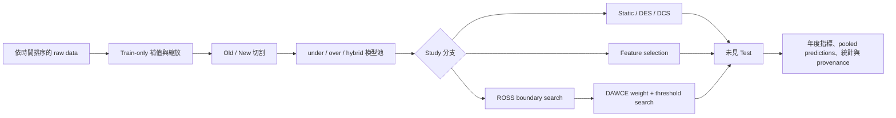

### 3.4 原始流程圖

前三階段已更新為簡化版，以 draw.io 為可編輯原始檔，並保存同名 PNG／SVG；
Phase 4 保留現行 PlantUML 原始檔。檔案位於 `assets/research/diagrams/`：

- [Study 1／Phase 1 baseline 流程](../assets/research/diagrams/phase1-baseline-flow.drawio)
- [Study 1 延伸／Phase 2 ensemble 流程](../assets/research/diagrams/phase2-ensemble-flow.drawio)
- [Study 2／Phase 3 feature-selection 流程](../assets/research/diagrams/phase3-fs-ensemble-flow.drawio)
- [Study 3／Phase 4 batch-adaptive 流程](../assets/research/diagrams/phase4-batch-adaptive-flow.puml)

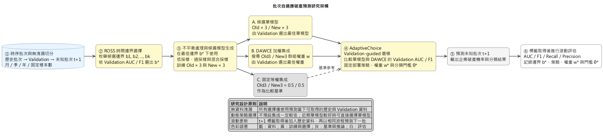

## 4. Study 1：基準模型與 Old/New 模型池

### 流程

1. 依時間建立 Old、New、Test。
2. 比較 Old-only、New-only、Old+New retraining 與 fine-tuning。
3. 每種訓練策略比較 none、under、over、hybrid。
4. 只以未見 Test 計算指標。

主要程式：[`experiments/phase1_baseline/`](../experiments/phase1_baseline/)。

### 結果

Bankruptcy XGBoost 15-split 摘要中，New-none AUC/F1 為
0.8438/0.2473，New-under 為 0.8397/0.2430；Old 系列 AUC 約
0.6536–0.6945，F1 約 0.0846–0.1046。這支持近期資料的重要性，但 15 個
切割互相重疊，不能視為 15 次獨立重複。

證據：[`bk_xgb_compact_summary.csv`](../results/phase1_baseline/xgb/bk_xgb_compact_summary.csv)。

判定：**方向性支持 New-side 模型；最終主張以 Study 3 rolling 結果為準。**

## 5. Study 1 延伸：靜態集成、DES 與 DCS

### 流程

1. 以六模型池建立 2–6 模型的靜態組合。
2. DES 以局部 competence 選模型子集；DCS 選單一模型。
3. 比較年度 AUC、F1、Recall。
4. `Static oracle best` 只作候選上界，不視為可部署方法。

主要程式：[`experiments/phase2_ensemble/`](../experiments/phase2_ensemble/)。

### 結果

七個摘要切割的最佳靜態組合平均 AUC/F1 為 0.8499/0.2523；不同切割的
最佳模型組合不完全一致。15-split 比較中，多數 static oracle 點高於 DES
與 DCS，但它依 Test 指標事後選模，因此不能用來宣稱某個預先指定的靜態
方法無偏地顯著優於 DES/DCS。

證據：

- [`xgb_oldnew_ensemble_static_professor_summary_bankruptcy.csv`](../results/phase2_ensemble/static/xgb_oldnew_ensemble_static_professor_summary_bankruptcy.csv)
- [`bankruptcy_phase2_xgb_static_des_dcs_points.csv`](../results/phase2_ensemble/model_comparison/plots/bankruptcy_phase2_xgb_static_des_dcs_points.csv)

判定：**動態選擇目前沒有穩定優勢；公平結論仍需獨立 Validation DSEL 與
validation-selected static baseline。**

## 6. Study 2：特徵選擇與穩定度

### 流程

1. 僅在允許的 fitting data 上執行 MI、SHAP、RFE、CART 等方法。
2. 比較 no-FS、保留 50%（r50）及 80%（r80）特徵。
3. 將相同欄位套用至 New、Validation、Test。
4. 以不同年份邊界的 Jaccard overlap 描述穩定度。

主要程式：[`experiments/phase3_feature/`](../experiments/phase3_feature/)。

### 結果

在進階 15-split 摘要中：

- no-FS New3：AUC/F1 = 0.8490/0.1893；
- MI-r80 New3：0.8537/0.1861；
- MI-r80 New-under：0.8451/0.2043；
- no-FS New-under：0.8397/0.2048。

FS 對 AUC 有局部提升，但沒有在 F1 上一致勝出。穩定度方面，多數 Old 或
New scope 的 r80 高於 r50，例如 New-MI Jaccard 0.8187 對 0.6677。
`old_new` 在不同邊界下實際使用相同 1999–2014 合併資料，其接近 1 的結果
是設計所致，不能當成額外穩定性證據。105 個 pair 也彼此相依，不可直接
當成 105 個獨立樣本做確認性檢定。

證據：

- [`xgb_bankruptcy_fs_advanced_summary.csv`](../results/phase3_feature/combined/xgb_bankruptcy_fs_advanced_summary.csv)
- [`bankruptcy_feature_stability_summary.csv`](../results/phase3_feature/stability/bankruptcy_feature_stability_summary.csv)

判定：**r80 通常較穩，但 FS 的預測增益不一致。**

## 7. Study 3：漂移偵測、ROSS、DAWCE 與 rolling

新增並已實作：[Study 3 B 路線：重疊窗口持續集成](Study3_B路線_重疊窗口持續集成提案.md)。A 路線是在已知、封閉的歷史年度範圍內人工界定候選空間，再由 Validation 搜尋 Old/New 切點；B 路線則預先固定更新規則，不需要知道未來資料內容或資料流終點，研究模型能否逐年演進。B 第一版採三年 fit 窗口、每年新增一模型、最多三模型、FIFO、固定等權，比較最新窗口單模型與 B-model FIFO。2009–2018 × 10 seeds 已執行完成，且已用同一事件 target、特徵、sampling、XGBoost 與年度契約完成公平 A/B 比較及 1,000 次 company-cluster bootstrap。另已加入可跨程序恢復的 `initialize/update/predict` runtime、模型與前處理 checkpoint、原子 registry、年度 label-maturity gate 及 label-blind prediction。因精確標籤可用時間仍無來源，定位仍是可恢復的年度研究 replay，而非已驗證的正式服務。

### 7.1 漂移偵測

比較 DDM、ADWIN、Page–Hinkley-style signal 與固定模型。當前摘要中
Fixed-New AUC/F1 為 0.8514/0.2998，高於列出的 detector variants；因此
「偵測到漂移」本身尚未轉化為較佳預測。

證據：[`bk_drift_summary.csv`](../results/phase4_drift/bk_drift_summary.csv)。

### 7.2 ROSS

ROSS（Retrospective Optimal Split Selection）是本專案命名的離線批次流程：
列舉 Old/New boundary，以 Validation 指標選擇邊界，再固定至 Test。它不是
外部既有方法，也不是逐筆 online learner。

validation-selected 版本選出 2009；no-FS `ValROSS_2009` AUC/F1 為
0.8418/0.1947，固定 2012 對照為 0.8409/0.2039。ROSS 改善 AUC 很小，
Test F1 反而較低，故不能宣稱 ROSS 普遍優於固定邊界。

證據：[`bk_validation_ross_weight_summary.csv`](../results/phase5_weighted/bk_validation_ross_weight_summary.csv)。

### 7.3 DAWCE

DAWCE（Drift-Aware Weighted Continual Ensemble）也是本專案命名。對
Old3 與 New3 的平均機率搜尋 `w_new`：

\[
p(x)=(1-w_{new})p_{old}(x)+w_{new}p_{new}(x)
\]

權重與 threshold 都由 Validation 選擇。公平消融的 no-FS Test 結果：

| 方法 | AUC | F1 | Recall | Precision |
|---|---:|---:|---:|---:|
| New_under | 0.8498 | 0.2143 | 0.5422 | 0.1354 |
| AdaptiveChoice_AUC | 0.8481 | 0.2028 | 0.5573 | 0.1248 |
| DAWCE_AUC | 0.8361 | 0.1878 | 0.5447 | 0.1144 |
| Equal6 | 0.8086 | 0.1611 | 0.5092 | 0.0966 |

證據：[`bk_fair_ablation_summary.csv`](../results/phase5_weighted/bk_fair_ablation_summary.csv)。

判定：**DAWCE/AdaptiveChoice 改善 Equal6，但沒有超越 `New_under`。**

### 7.4 Rolling walk-forward（目前主結果）

對 2009–2018 十個互不重疊的年度 Test batch，以截至前一期可用的資料進行
expanding-window 選擇；每個方法共有 33,636 筆 pooled out-of-time 預測。

| 方法 | pooled AUC | pooled F1 | Recall | Precision |
|---|---:|---:|---:|---:|
| New_under | **0.8403** | **0.3287** | **0.3673** | 0.2975 |
| DAWCE_AUC | 0.8237 | 0.3275 | 0.3392 | **0.3165** |
| AdaptiveChoice_AUC | 0.8221 | 0.3283 | 0.3652 | 0.2982 |
| Retrain_under | 0.8116 | 0.2943 | 0.3146 | 0.2764 |
| Equal6 | 0.7971 | 0.2830 | 0.3553 | 0.2351 |

以年度為 paired unit、16 項比較採 Holm 校正後，只有
AdaptiveChoice_AUC 相對 Equal6 的 AUC 通過校正（平均差 +0.0327，raw
`p=0.001953`，Holm `p=0.031250`）。AdaptiveChoice 相對 `New_under`
的 AUC、F1、Recall、Precision 都不顯著。

證據：

- [`rolling_pooled_summary.csv`](../results/phase_flexible/rolling_bankruptcy/rolling_pooled_summary.csv)
- [`rolling_by_year.csv`](../results/phase_flexible/rolling_bankruptcy/rolling_by_year.csv)
- [`rolling_predictions.csv`](../results/phase_flexible/rolling_bankruptcy/rolling_predictions.csv)
- [`rolling_wilcoxon_holm.csv`](../results/phase_flexible/rolling_bankruptcy/rolling_wilcoxon_holm.csv)

判定：**確認 validation-guided selection 可避免 Equal6 的 AUC 損失，但沒有
確認其優於強近期單模型。**

### 7.5 B 路線：重疊窗口持續集成（新事件 target）

新 B protocol 只使用 `X1`–`X18`，把 failed 公司最後觀測年當作次年事件
target；2009–2018 共 33,636 個不重複 company-year Test 列、289 個正例。
每個 seed 的 pooled 結果如下：

| 方法 | AP | AUC | F1 | Recall | Precision |
|---|---:|---:|---:|---:|---:|
| B-model FIFO3 equal | **0.1215** | **0.8576** | **0.1917** | **0.2145** | 0.1732 |
| Recent3y | 0.0966 | 0.8450 | 0.1656 | 0.1384 | **0.2062** |

B-model 的 pooled AP 比 Recent3y 高 0.0249、AUC 高 0.0126；以年度等權平均
則 AP 差 +0.0199，10 年中 6 年較高，AUC 10 年中 8 年較高。這是方向性
結果，不是已確認優勢：年度彼此相依、尚無 company-cluster CI，且五項年度
paired 檢查若考慮多重比較，不能只挑未校正的單一 p-value 下結論。

10 個 configured seeds 的所有指標標準差均為 0，原因是 TomekLinks 與目前
XGBoost 未使用會隨 seed 改變的 subsampling；這證明設定可重現，但**不是**
演算法不確定性或外部穩定性的證據。

這裡的 2009–2018 是回測人員用來評估的範圍，不是 B 演算法在 2009 年已知
的未來邊界。每輪只依當時允許的資料建立／保留模型；`LAST_TEST_YEAR` 僅
控制實驗停止點，不參與預測或模型更新。B 的永續性應以「不重新搜尋全部
歷史、模型池與每輪新增成本有界、可接收下一個未知年度」來定義，而不是
宣稱未來準確率永久不衰退。

證據：[`study3b_seed_summary.csv`](../results/phase_flexible/study3b_overlap/runs/20260908T170653753411Z/study3b_seed_summary.csv)、
[`seed_42/study3b_by_year.csv`](../results/phase_flexible/study3b_overlap/runs/20260908T170653753411Z/seed_42/study3b_by_year.csv)、
[`run_manifest.json`](../results/phase_flexible/study3b_overlap/runs/20260908T170653753411Z/run_manifest.json)。

#### Old/New 同步滑動延伸（2026-09-15）

為符合「Old 也必須由最舊逐步推移到最新」的研究設計，已完成 16 輪固定
rolling-origin：模型 `M_e` 以 Old=`e−2,e−1`、New=`e` 訓練，以 `e+1`
Validation 選門檻，再以 `e+2` Test；下一輪整個窗口前移一年。FIFO 暖機後
保留最近三個 `M_e`，舊模型淘汰與否、權重及窗口寬度均不看 Test。

2003–2018 共 58,600 個 Test company-year、572 個正例。FIFO3 與當輪最新
三年模型的 pooled AP 分別為 0.0860/0.0730，Recall 為 0.1923/0.1416，
Precision 為 0.1259/0.1366。FIFO 多找到 29 個正例，也多產生 252 個假陽性。
1,000 次 paired company-cluster bootstrap 的 FIFO−最新模型 AP 差為 +0.0130
（95% CI [0.0019, 0.0241]），Recall 差 +0.0507（[0.0284, 0.0748]）；
AUC、F1 與 Precision 的 intervals 跨 0。只分析完整 Pool3 的 2005–2018，
AP 與 Recall 的 intervals 仍未跨 0。

這支持整體 rolling FIFO 設計在目前資料中提高少數類排序與召回，但不是每年
必勝，也不能單獨歸因於 ensemble：Pool3 同時把有效歷史涵蓋由三年擴成五年。
凍結模型在所有後續年度共形成 136 個 model-year 老化組合；平均 AP 從年齡
2 年的 0.0946 大致降至 10 年的 0.0374。此結果受出生年度 cohort 混雜，僅
支持需要持續更新的描述性論點，不是模型年齡的因果估計。

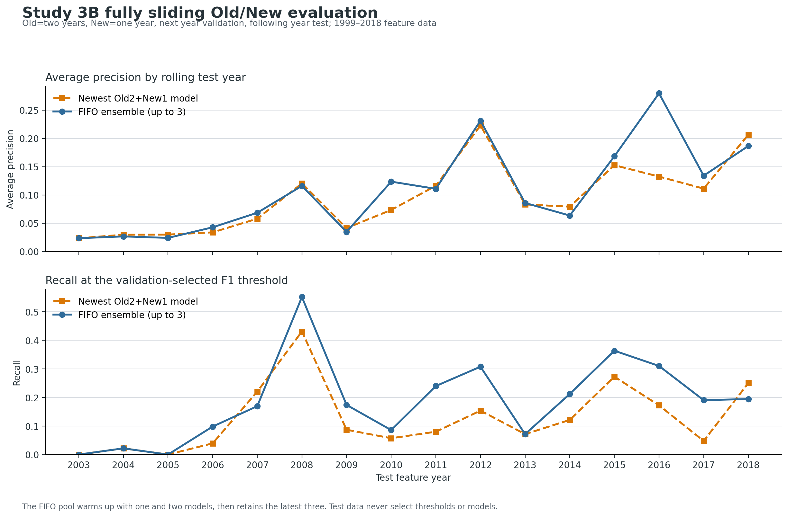

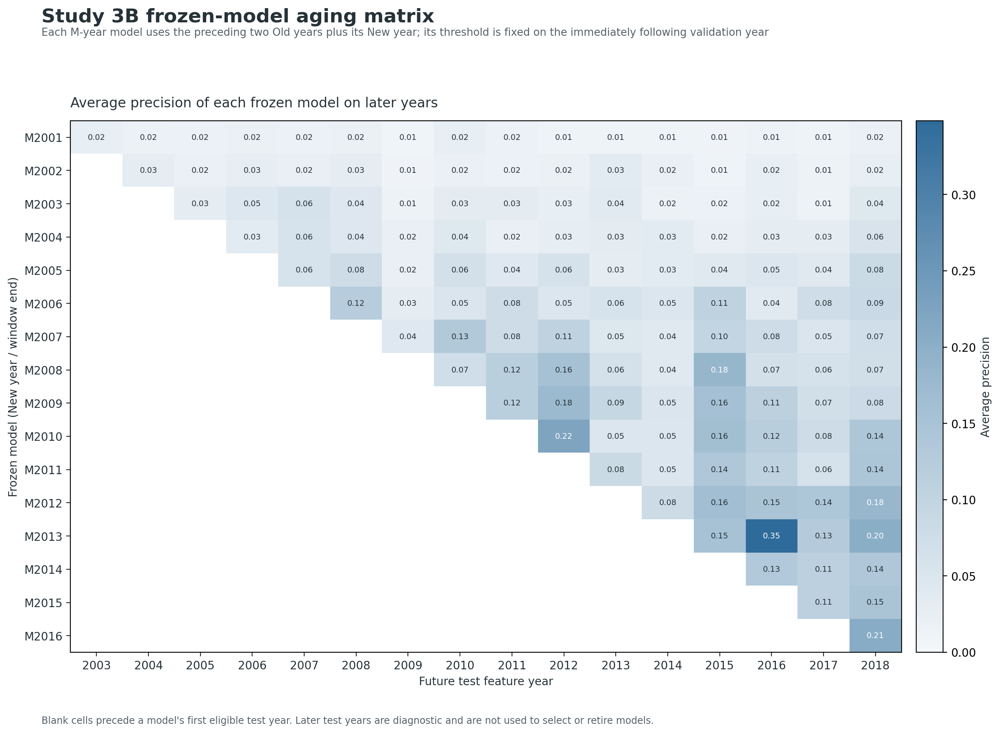

完整 16 輪 AP、AUC、F1、Recall 與 Precision 已列於
[`研究成果與未來研究方向報告.md`](研究成果與未來研究方向報告.md#b-路線全滑動實驗old-與-new-一起逐年推移)。

證據：[`sliding_protocol.csv`](../results/phase_flexible/study3b_sliding_old_new/runs/20260914T233351370315Z/sliding_protocol.csv)、[`sliding_primary_by_year.csv`](../results/phase_flexible/study3b_sliding_old_new/runs/20260914T233351370315Z/sliding_primary_by_year.csv)、[`sliding_primary_pooled.csv`](../results/phase_flexible/study3b_sliding_old_new/runs/20260914T233351370315Z/sliding_primary_pooled.csv)、[`paired_company_cluster_bootstrap.csv`](../results/phase_flexible/study3b_sliding_old_new/runs/20260914T233351370315Z/analysis/20260914T234337062081Z/paired_company_cluster_bootstrap.csv)、[`run_manifest.json`](../results/phase_flexible/study3b_sliding_old_new/runs/20260914T233351370315Z/run_manifest.json)。

#### B-model Sampling 消融（2026-09-11）

在相同事件 target、2009–2018 Test 年、三年窗口、FIFO3、等權集成、
X1–X18、XGBoost 與 Validation threshold 規則下，以 seed 42 比較 Training-only
的不平衡處理；Validation/Test 均保留自然分布：

| 處理 | AP | AUC | F1 | Recall | Precision | Recall@5% FPR |
|---|---:|---:|---:|---:|---:|---:|
| None | 0.1176 | 0.8576 | **0.1921** | 0.1938 | **0.1905** | **0.4291** |
| TomekLinks | **0.1215** | **0.8576** | 0.1917 | **0.2145** | 0.1732 | 0.4014 |
| `scale_pos_weight` | 0.1094 | 0.8428 | 0.1725 | 0.2042 | 0.1494 | 0.3875 |

相對 None，Tomek 的 pooled AP 為 +0.0039、AUC 約 +0.00001、F1 為
-0.00046；它提高由逐年 Validation 選 F1 threshold 後的 Recall，但降低
Precision，而且在 5% FPR 預算下的 Recall 反而較低。Tomek 在 12 個實際新增
B-model fit 中只移除 353 / 134,321 個多數類訓練列，沒有移除或合成正例。

以 5,512 家公司做 1,000 次 paired company-cluster bootstrap，Tomek−None
的 AP 95% interval 為 [-0.0084, 0.0175]，AUC 為 [-0.0091, 0.0077]，其餘
F1／Recall／Precision 差異區間也都跨 0。因此目前只能說 **Tomek 在 pooled
AP 上方向性最佳，尚未證明優於不採樣**。Tomek 相對未調參的
`scale_pos_weight`，只有 AUC 差的 interval 未跨 0；這不能推論成本敏感學習
普遍較差，因本輪固定其他 XGBoost 參數，正類權重亦未經 Validation 選擇。

證據：[`sampling_ablation_pooled_summary.csv`](../results/phase_flexible/study3b_sampling_ablation/analysis/20260910T175100152579Z/sampling_ablation_pooled_summary.csv)、
[`sampling_ablation_bmodel_company_bootstrap.csv`](../results/phase_flexible/study3b_sampling_ablation/analysis/20260910T175100152579Z/sampling_ablation_bmodel_company_bootstrap.csv)、
[`analysis_manifest.json`](../results/phase_flexible/study3b_sampling_ablation/analysis/20260910T175100152579Z/analysis_manifest.json)。

#### B-model Pool size 消融（2026-09-11）

固定三年窗口、TomekLinks、XGBoost、等權及相同 Validation/Test 契約，比較
FIFO 模型池容量 1／2／3／5；Pool3 是事前既定主設定，其餘是探索性敏感度：

| Pool size | AP | AUC | F1 | Recall | Precision | Recall@5% FPR |
|---:|---:|---:|---:|---:|---:|---:|
| 1 | 0.0966 | 0.8450 | 0.1656 | 0.1384 | **0.2062** | 0.3910 |
| 2 | 0.1178 | 0.8529 | **0.2003** | 0.2076 | 0.1935 | 0.3772 |
| 3 | 0.1215 | 0.8576 | 0.1917 | **0.2145** | 0.1732 | 0.4014 |
| 5 | **0.1248** | **0.8626** | 0.1646 | 0.1799 | 0.1516 | **0.4221** |

Pool3 相對 Pool1 的 pooled AP/AUC/Recall 差為 +0.0249／+0.0126／+0.0761；
5,512-company、1,000 次 paired cluster bootstrap 的 95% intervals 分別為
[0.0061, 0.0450]、[0.0007, 0.0260]、[0.0397, 0.1133]，均未跨 0。這支持
「加入歷史窗口模型」的機制，而 F1 與 Precision 差仍跨 0。

Pool3 相對 Pool2 的全部五項差異區間皆跨 0。Pool5 的 pooled AP/AUC 雖最高，
相對 Pool3 的差異區間仍跨 0；Pool3 的 thresholded Recall 則高於 Pool5，差
0.0346，interval [0.0034, 0.0680]。因此 **Pool3 不是已證明的最佳容量**；
目前較合理的判讀是 Pool1→2 有明顯增益，2–5 間呈現 ranking、Recall、
Precision 的取捨及效益飽和。

初始化需訓練的模型數隨容量增加，但之後九次年度更新在四種容量下都只新增
九個模型，符合每輪新增成本有界的設計。此處尚未納入 wall time、記憶體、
磁碟成本及未來年度變異，不能只依 pooled Test 排名把 Pool5 改成主設定。

證據：[`pool_ablation_pooled_summary.csv`](../results/phase_flexible/study3b_pool_ablation/analysis/20260910T181408321502Z/pool_ablation_pooled_summary.csv)、
[`pool_ablation_company_bootstrap.csv`](../results/phase_flexible/study3b_pool_ablation/analysis/20260910T181408321502Z/pool_ablation_company_bootstrap.csv)、
[`pool_ablation_training_audit.csv`](../results/phase_flexible/study3b_pool_ablation/analysis/20260910T181408321502Z/pool_ablation_training_audit.csv)、
[`analysis_manifest.json`](../results/phase_flexible/study3b_pool_ablation/analysis/20260910T181408321502Z/analysis_manifest.json)。

#### B-model Window width 消融（2026-09-11）

固定 Pool3、TomekLinks、XGBoost、等權及相同 Validation/Test 契約，比較每個
凍結基模型使用 1／3／5 個財政年度：

| Window | AP | AUC | F1 | Recall | Precision | Recall@5% FPR |
|---:|---:|---:|---:|---:|---:|---:|
| 1 年 | 0.1142 | 0.8536 | **0.2010** | 0.2007 | **0.2014** | 0.3633 |
| 3 年 | **0.1215** | **0.8576** | 0.1917 | 0.2145 | 0.1732 | 0.4014 |
| 5 年 | 0.1106 | 0.8571 | 0.1672 | **0.2664** | 0.1218 | **0.4152** |

Window3 相對 Window1/5 的 AP 與 AUC paired company-bootstrap intervals 均跨
0。Window5 Recall 高於 Window3 0.0519，但 Precision 低 0.0513，兩者區間
未跨 0；累積 fitting rows 則為 44,098／135,671／232,014。因此三年只是主
設定，不是已證明最佳；不同窗口對少數類 Recall、Precision 與更新成本形成取捨。

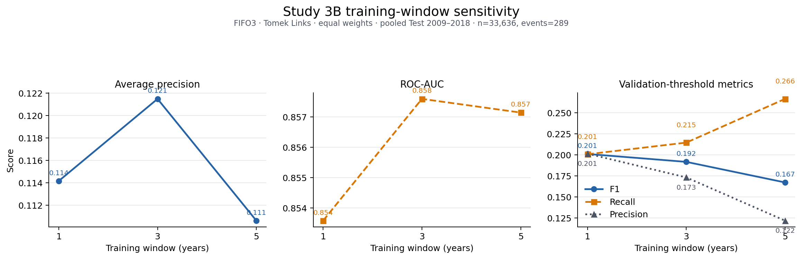

證據：[`window_ablation_pooled_summary.csv`](../results/phase_flexible/study3b_window_ablation/analysis/20260911T021739729683Z/window_ablation_pooled_summary.csv)、
[`window_ablation_company_bootstrap.csv`](../results/phase_flexible/study3b_window_ablation/analysis/20260911T021739729683Z/window_ablation_company_bootstrap.csv)、
[`window_ablation_training_audit.csv`](../results/phase_flexible/study3b_window_ablation/analysis/20260911T021739729683Z/window_ablation_training_audit.csv)。

#### 2／3／5／7 年訓練窗口敏感度（2026-09-21 分析更新）

依老師對 Old2＋New1 是否需要擴大歷史範圍的建議，已完成 2026-09-16 的四窗口×十種子實驗。固定 Pool3、FIFO、等權、TomekLinks 與既有 XGBoost，每個窗口同時評估最新單模型與 FIFO3。所有配置共用 2009–2018 Test：33,636 筆 company-year、5,512 家公司、289 個事件。七年窗口的完整三模型池需自 1999 年初始化，因此不把短窗口額外可用的早期 Test 混入比較。

| 窗口 | Old＋New 年數 | FIFO3 年度平均 AP | FIFO3 pooled AP | Newest pooled AP | FIFO3 Recall | FIFO3 Precision |
|---:|---|---:|---:|---:|---:|---:|
| 2 年 | 1＋1 | 0.1474 | 0.1274 | 0.0813 | 0.1661 | 0.1771 |
| 3 年 | 2＋1 | 0.1418 | 0.1215 | 0.0966 | 0.2145 | 0.1732 |
| 5 年 | 4＋1 | 0.1307 | 0.1106 | 0.1050 | 0.2664 | 0.1218 |
| 7 年 | 6＋1 | 0.1291 | 0.1082 | 0.1107 | 0.2388 | 0.1417 |

兩年 FIFO3 的 AP 點估計最高，七年 AUC 最高（0.8667），五年 Recall 最高；三年在四種 FIFO3 配置中具有最高 F1（0.1917）。這是指標間取捨，不支持「歷史越長越好」。七年 FIFO3 的年度 AP SD 為 0.0930，亦不能宣稱擴大窗口必然穩定。兩年、三年、五年、七年的每 seed 累積 fitting rows 為 89,353、135,671、232,014、335,047；每組均訓練 12 個模型，共計 480 次實際擬合。

三年減兩年、五年、七年的 pooled AP 差分別為 -0.0059／0.0109／0.0133，公司 95% CI 為 [-0.0247, 0.0133]／[-0.0096, 0.0313]／[-0.0108, 0.0379]，均跨零；兩種年度區塊長度下的年度 AP 差區間也均跨零。三年 FIFO3 對三年 Newest 的公司 AP 差區間 [0.0054, 0.0434] 未跨零，但年度區塊 2／3 年的區間 [-0.0037, 0.0542]／[-0.0003, 0.0483] 跨零，因此不能將公司群聚證據延伸為未來年度穩健性。十個 seed 逐筆結果完全一致，不是十份獨立資料重現。

本實驗是**總歷史長度敏感度**：Old/New 合併訓練同一個基模型，沒有測固定總跨度下的分組比例或權重。FIFO3 歷史聯集是 $L+2$ 年，單模型與集成差異不能視為純模型保留效果。三年仍保留為原先指定基準，不依本次 Test 排名事後改選。完整設計、單模型對照、區間與成本見論文 §3.10.5、§4.5.6.1。

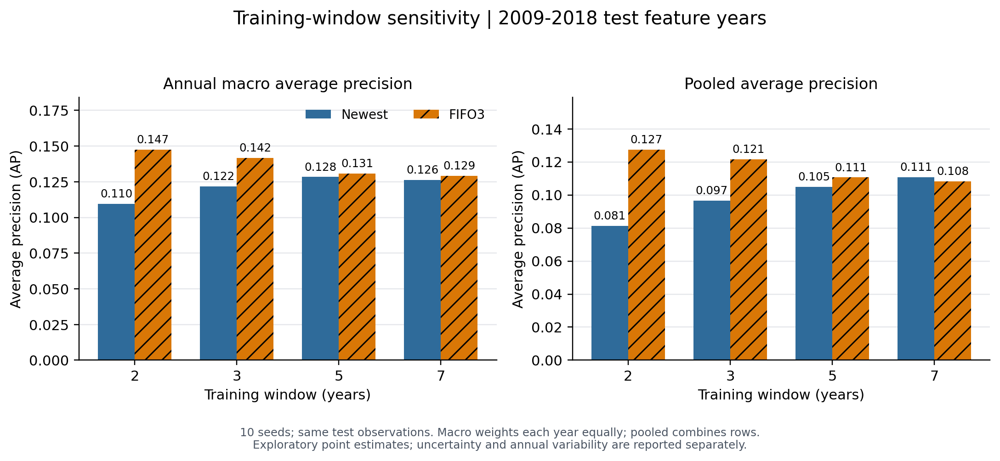

不確定性證據：[公司群聚 bootstrap](../results/phase_flexible/study3b_window_sensitivity/runs/20260916T151731817838Z/analysis/20260920T194618884788Z/company_bootstrap.csv)、[年度區塊敏感度](../results/phase_flexible/study3b_window_sensitivity/runs/20260916T151731817838Z/analysis/20260920T194618884788Z/annual_block_sensitivity.csv)、[分析 manifest 與十種子查核](../results/phase_flexible/study3b_window_sensitivity/runs/20260916T151731817838Z/analysis/20260920T194618884788Z/analysis_manifest.json)。兩種區間針對不同 AP 摘要，皆為固定預測、未校正多重比較的探索性區間，未涵蓋重訓或公司×時間的聯合變異。

證據：[run manifest](../results/phase_flexible/study3b_window_sensitivity/runs/20260916T151731817838Z/manifest.json)、[summary.csv](../results/phase_flexible/study3b_window_sensitivity/runs/20260916T151731817838Z/analysis/20260920T194618884788Z/summary.csv)、[逐年與種子指標](../results/phase_flexible/study3b_window_sensitivity/runs/20260916T151731817838Z/analysis/20260920T194618884788Z/by_year_all_seeds.csv)、[成本](../results/phase_flexible/study3b_window_sensitivity/runs/20260916T151731817838Z/analysis/20260920T194618884788Z/cost_by_seed.csv)。實驗入口為 `experiments/phase_flexible/study3b_window_sensitivity.py`，分析入口為 `scripts/analysis/analyze_study3b_window_sensitivity.py`。

### 7.6 已生成的結果圖

以下圖表由已保存的結果檔產生，原圖保存在 `results/report_figures/`，不因
`docs/` 的文字文件整併而刪除。

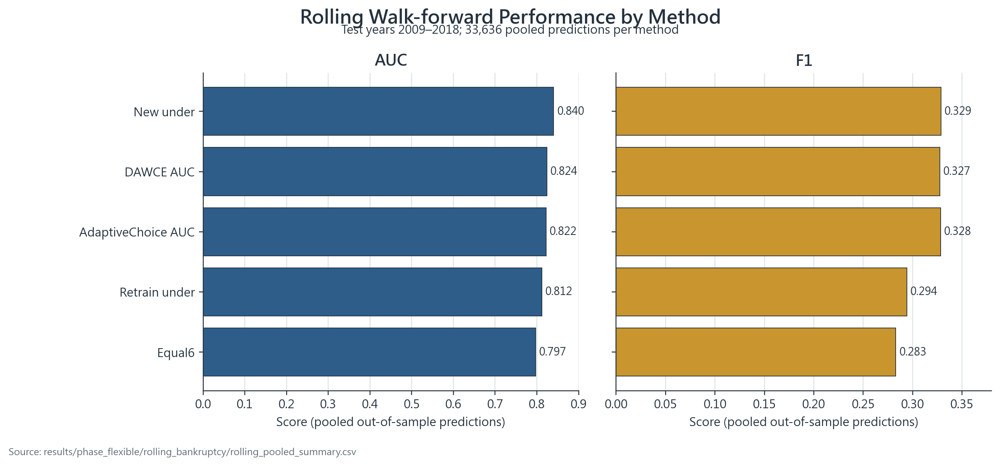

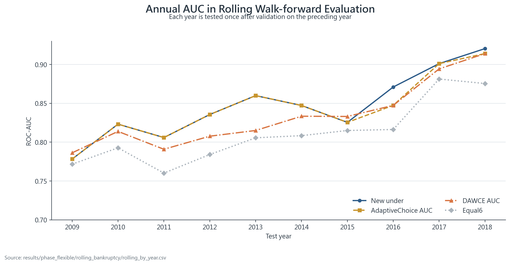

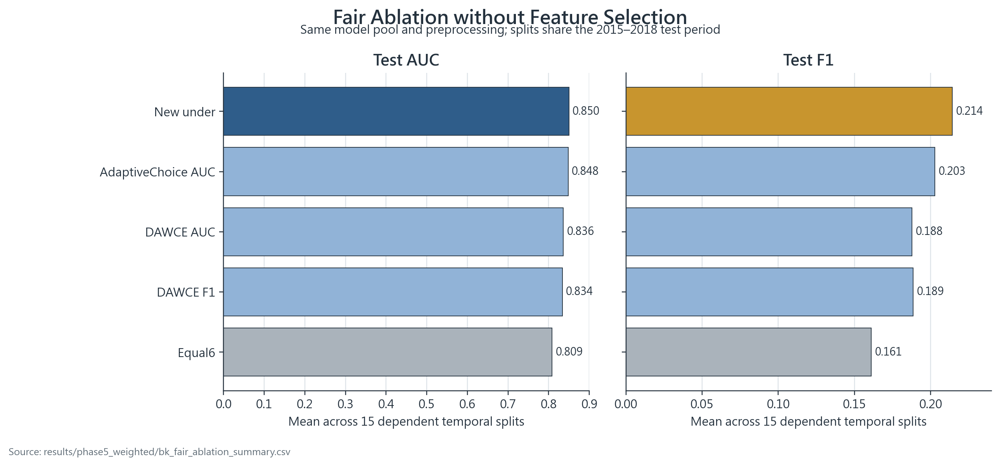

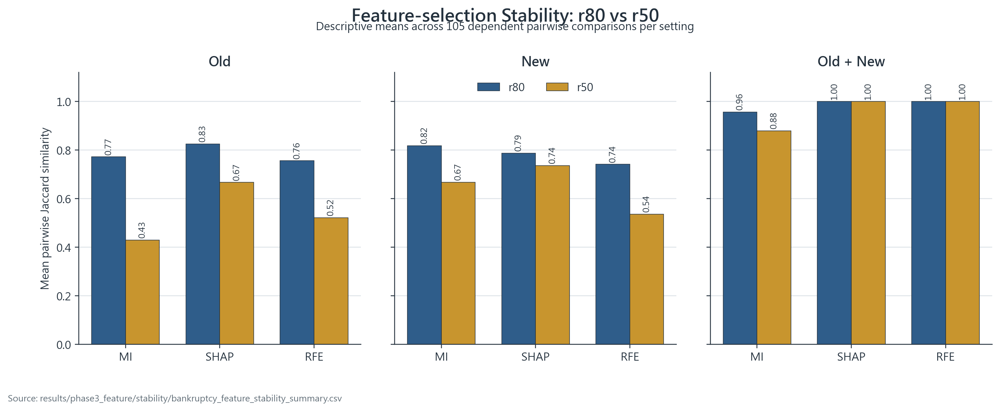

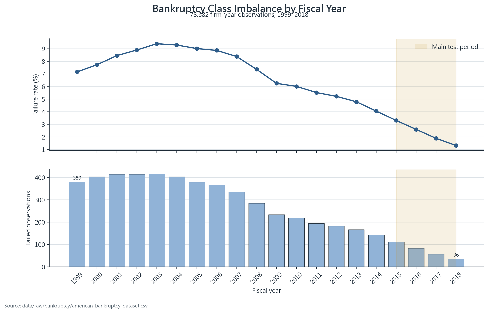

## 8. Study 4：多種子與成本敏感度

### 流程與結果

既有 10-seed 檔案使用 LightGBM/block-CV，並非主 XGBoost rolling
protocol。產生舊結果時 DES 未接收外部 seed，因此 DES 標準差為 0。程式
已修正 seed 傳遞，但舊結果尚未重跑，不能用來確認主結論的多種子重現性。

證據：[`bankruptcy_multi_seed.csv`](../results/multi_seed/bankruptcy_multi_seed.csv)。

目前成本表使用 `FPR + r × FNR`，它是盛行率中性的條件錯誤分數，不是每家
公司的 expected cost。真正部署成本至少應寫為：

\[
(1-\pi)c_{FP}\,FPR+\pi c_{FN}\,FNR
\]

其中 `π` 是部署族群正類盛行率，`c_FP`、`c_FN` 是實際成本。

判定：**Study 4 目前只能作探索性敏感度診斷。**

## 9. 整體結論與可信度

| 主張 | 判定 | 可使用的措辭 |
|---|---|---|
| New-side 模型通常比 Old-side 好 | 支持，限 Bankruptcy | 近期資料模型是重要強基準 |
| AdaptiveChoice 優於 Equal6 | 部分支持 | 年度 AUC 經 Holm 校正顯著 |
| DAWCE 優於所有單模型 | 不支持 | DAWCE 改善等權集成，但未勝 New-under |
| ROSS 優於固定邊界 | 不支持普遍性 | Validation 可自動選邊界，但 Test 增益不一致 |
| FS 一定提升效能 | 不支持 | r80 較穩，效能提升依方法與指標而異 |
| Static 顯著優於 DES/DCS | 僅探索 | static oracle 是事後上界，不是公平部署比較 |
| 主結論跨 seed 重現 | 未完成 | 舊 multi-seed 與主 protocol 不一致 |
| 方法可跨領域泛化 | 未完成 | 主要統計證據只有 Bankruptcy |

整體研究狀態：**Share with caveats／論文仍需修訂**。數值與流程可向指導
教授報告，但正式投稿前必須保留上述限制，不可把非顯著結果寫成等效，也
不可把 Test-selected oracle 寫成可部署方法。

## 10. 待做清單

### P0：投稿前必要

- [ ] 用修正後的 YAML sampling 與 seed 傳遞重新產生主要結果。
- [x] 完成 Study 3 B 的 2009–2018 × configured seeds 執行；結果顯示目前
  pipeline 為決定性，後續不以重複相同 seed run 取代統計不確定性分析。
- [x] 完成 Old/New 同步逐年滑動的 2003–2018 共 16 輪回測、FIFO 暖機、
  凍結模型跨年老化矩陣及公司群集 bootstrap；AP／Recall 支持 FIFO 整體
  設計，但 AUC／F1／Precision 差異區間跨 0。
- [x] 在相同事件 target、年度、特徵、sampling 與固定等權設定下重跑
  Validation-selected A 路線；舊 status-label A 結果仍不得拼接為主比較。
- [x] 將 B 擴充為可恢復的 `initialize/update/predict` 流程，保存模型與前處理、
  原子 pool registry、年度 maturity gate 與 label-blind predictions。
- [ ] 以具真實 filing/report availability timestamp 的權威標籤來源取代年度
  重建 gate；目前只能支持 retrospective annual replay。
- [ ] 量測 B 每輪訓練時間、模型檔大小、峰值記憶與 raw-buffer 用量，確認
  「永續」不只是概念，而是具備有界更新成本的實證。
- [ ] 以同一 XGBoost rolling protocol 執行完整 10+ seeds，保存逐 seed、
  逐年度 predictions、失敗紀錄與 experiment ID。
- [ ] 修正所有舊 Phase 4/5 路徑，使 imputation/scaling/FS 僅以 fitting data
  擬合，並重跑受影響結果。
- [ ] 以獨立 Validation DSEL 重做 DES/DCS，並加入 validation-selected
  static baseline，取代 Test-selected oracle 的確認性比較。
- [x] 對公平 A/B rolling predictions 執行 1,000 次 company-cluster bootstrap，
  提供 AP、AUC、F1、Recall、Precision 方法差與 95% percentile interval。
- [ ] 補時間 block uncertainty；company bootstrap 不能單獨代表未來年度變異。
- [x] 完成 B-model 的 None／TomekLinks／`scale_pos_weight` Training-only 初步
  Sampling 消融；Tomek 的 pooled AP 方向性最高，但相對 None 的 company
  bootstrap intervals 全部跨 0，不能宣稱採樣貢獻已確認。
- [ ] 對 Sampling 消融補時間 block uncertainty；若繼續比較 RandomUnderSampler
  或 SMOTE，需先預註冊主要指標與比較順序，避免在 Test 上挑最佳方法。
- [x] 完成 Pool size 1／2／3／5 消融與 company-cluster bootstrap；確認 Pool3
  相對 Pool1 的 AP/AUC/Recall 增益，但未確認 Pool3 優於 Pool2 或 Pool5。
- [ ] 補 Pool size 的時間 block uncertainty 與每輪 wall time／RAM／模型大小；
  在獨立 Validation 規則確立前維持 Pool3，不以本次 Test 排名改選 Pool5。
- [x] 完成 Window width 1／3／5 消融與 company-cluster bootstrap；三年 AP
  點估計最高，但相對一年／五年的 AP/AUC intervals 跨 0，且五年 Recall
  較高、一年 F1/Precision 與 fitting 成本較佳。
- [ ] 補 Window width 的時間 block uncertainty；維持事前三年主設定，不依
  本次 Test 事後改選窗口。
- [ ] 完成 entity-holdout 與 seen/unseen-company 分層分析。
- [ ] 一致補報 PR-AUC、Balanced Accuracy、calibration/Brier score。

### P1：提高論文強度

- [ ] 用相同 protocol 完成 Medical 外部驗證。
- [ ] Medical 採 patient/group-safe 時序切割，避免同一病人跨集合。
- [ ] 特徵穩定性改用 split-level permutation、temporal bootstrap 或
  Nogueira stability，不把 105 個重疊 pair 當獨立樣本。
- [ ] 將 SHAP 選出特徵與 Altman/Ohlson 財務理論連結。
- [ ] 加入 prevalence 與可辯護金額成本，重做部署情境分析。

### P2：工程品質

- [x] 修正 TabM 摘要階段未定義 `args`（2026-10-12）。
- [ ] 核對完整 Ruff 的其餘提示，按用途處理歷史與一次性工具。
- [ ] 將 `FeatureSelector` 的 seed、模型與 GA 參數完整接至 YAML。
- [ ] 為每個新結果保存 command、seed、commit、data hash 與 package versions。
- [ ] 確認 GitHub Actions 在 Python 3.11–3.14 的乾淨環境全部通過。

## 11. 安裝、執行與重現

標準環境鎖定於 `requirements.txt`，支援 CPython 3.11–3.14。建議 3.11 或
3.12，以取得跨平台 wheel 與第三方套件的最大相容性。

```powershell
py -3.11 -m venv .venv
.\.venv\Scripts\Activate.ps1
python -m pip install --upgrade pip
python -m pip install -r requirements.txt
python -m pip check
python -m pytest -q
python scripts/run/run_all_experiments.py --list
```

標準 requirement 保證目前維護的 CPU 主線；舊 FT-Transformer 的 `rtdl`
要求 Torch `<2`，而 TabM 等現代路徑使用 Torch 2.x，無法在不犧牲相容性的
情況下合併為同一標準 venv。這些深度模型應視為選用 baseline，依實際模型
另建環境，並在結果中記錄 backend、checkpoint、Torch/CUDA 版本。

結果完整性檢查：

```powershell
python scripts/analysis/validate_result_artifacts.py results --strict
python scripts/analysis/generate_result_manifest.py
```

目前 manifest：[`RESULT_MANIFEST.json`](../results/RESULT_MANIFEST.json)。

## 12. 主張來源台帳

範圍決策：2026-09-29 依使用者指示移除 B-data 主線及分組比例實驗，已同步 B-model 執行入口。C30–C32 隨分組分支退出主張台帳，歷史結果見[封存紀錄](archive/study3b_b_data/README.md)。


| ID | 主張 | 來源 | 狀態 |
|---|---|---|---|
| C1 | Rolling New-under AUC/F1 0.8403/0.3287 | `rolling_pooled_summary.csv` | verified |
| C2 | AdaptiveChoice 對 Equal6 年度 AUC Holm p=0.03125 | `rolling_wilcoxon_holm.csv` | verified |
| C3 | AdaptiveChoice 未顯著優於 New-under | 同上 | verified |
| C4 | Fair ablation 中 New-under 高於 DAWCE 與 Equal6 | `bk_fair_ablation_summary.csv` | verified；相依 splits |
| C5 | r80 多數比 r50 穩定 | `bankruptcy_feature_stability_summary.csv` | qualified；pair 非獨立 |
| C6 | 既有 audit 記錄 1,171 個 CSV、2,508,016 列且 strict issues=0 | `RESULT_MANIFEST.json` 與 audit script | qualified at 2026-09-11；只支持該次可讀性檢查，不證明無跨檔重複 artifact、無 leakage 或指標語義正確；manifest 共索引 1,249 個 result files |
| C7 | 主流程已完成多種子重現 | 無 | missing；不得主張 |
| C8 | 方法可跨資料集泛化 | 無對齊 protocol | missing；不得主張 |
| C9 | 本地 failed 列已符合逐年事件與當時可用性 | B 提案第 11 節；上游 bytes 一致、候選最後年度事件計數吻合 | 來源一致已驗證；逐公司事件與 label availability 仍 unresolved |
| C10 | 已修正 advanced core 的 FS 隔離並增加主 rolling 多 seed 執行能力 | core、rolling 及 `tests/test_bankruptcy_research_protocol.py` | implementation tested；非正式實驗完成 |
| C11 | 舊 New_under 是固定近期窗口 | 舊 rolling `_run_year` 從 ROSS pool 取出模型 | 不成立；新版名為 ROSS_New_under，固定窗口另列 |
| C12 | B 第一版採等權、三年窗口、FIFO、最新窗口單模型/B-model 比較 | 使用者回覆、B 提案與 B 入口 | implementation verified；目標為少數類辨識 |
| C13 | B 路線已具備持久 FIFO pool、獨立前處理、衍生事件 target、Test 隔離與版本化輸出 | `rolling_bankruptcy_overlap_ensemble.py`、研究協定測試、正式 run manifest | implementation verified |
| C14 | 新 target 的 B-model pooled AP/AUC 0.1215/0.8576，高於 Recent3y 0.0966/0.8450 | fair run pooled summary 與 company bootstrap | verified；AP 差 CI 0.0045–0.0449、AUC 差 0.0002–0.0248，F1 差 CI 跨 0 |
| C15 | B 的 10 seeds 完全相同 | 同一 run 的 seed summary 與逐 seed outputs | verified；pipeline 決定性，不代表外部穩定 |
| C16 | A 是已知封閉範圍內的離線選擇，B 是不預知未來內容與終點的持續更新研究 | 使用者／教授定位與 B protocol | framing confirmed |
| C17 | B runtime 可跨程序恢復、逐年只新增一模型，且 predict 不讀事件 label | runtime source、tests、2009–2012 smoke manifests | implementation verified；年度回溯 replay |
| C18 | B 已符合真實世界標籤可用時間 | 無 filing/report timestamp | missing；不得宣稱正式部署有效 |
| C19 | 公平設定下 B-model pooled AP/AUC/F1 高於 A validation-boundary equal | `20260909T122839561377Z` pooled summary 與 company bootstrap | verified descriptive；AP/AUC/F1 方法差 CI 均跨 0，不得宣稱顯著優於 A |
| C20 | A/B 公平比較已具有相同計算預算 | sampling audit：A 210 個 boundary 候選模型，B-model 12 次實際新增 | 不成立；目前只控制資料／模型／評估契約，equal-compute ablation 待補 |
| C21 | TomekLinks 對 B-model 的貢獻已確認 | Sampling 消融 pooled summary 與 company bootstrap | 不支持；AP 方向性高於 None，但 AP/AUC/F1/Recall/Precision 差異區間均跨 0 |
| C22 | Pool3 整體設計相對 Pool1 的 AP/AUC/Recall 較高 | Pool size 消融與 company bootstrap | qualified；K 改變同時增加歷史聯集 L+K−1，不能單獨歸因於模型保留；對同五年資訊範圍 Recent5y 的 AP 差 CI 跨零；不代表 Pool3 最佳 |
| C23 | 三年窗口是 B-model 的最佳窗口 | Window width 消融與 company bootstrap | 不支持；三年 AP 點估計最高但 ranking 區間跨 0，1/3/5 年在 Recall、Precision、成本間取捨 |
| C24 | B 主門檻抓出 62/289 正例；validation-FPR 門檻抓出 116/289，伴隨 1,405 誤報 | `results/phase_flexible/study3b_minority_analysis/analysis/20260914T025025467597Z/` 的 pooled／by-year CSV，由 fair predictions 重算 | verified at 2026-09-14；三個測試年度實現 FPR 超過 5%，不可將 validation 限制當作 test 保證 |
| C25 | 論文章節齊全不等於研究可定稿 | 論文、實作、逐筆結果與原始文獻交叉核對 | Needs revision；詳見完整性審查文件，須修目標／特徵／A 比較範圍與引註 |
| C26 | Old/New 同步滑動的 FIFO3 比每輪最新三年模型具有較高 AP 與 Recall | `study3b_sliding_old_new` 16 輪 predictions、pooled summary 與 company-cluster bootstrap | qualified；AP 差 CI [0.0019, 0.0241]、Recall [0.0284, 0.0748]，但 AUC/F1/Precision 跨 0，且歷史涵蓋同時改變，不得宣稱純集成或全面優勢 |
| C27 | 2／3／5／7 年 FIFO3 的年度平均 AP 為 0.1474／0.1418／0.1307／0.1291，延長窗口未帶來單調改善 | `study3b_window_sensitivity/runs/20260916T151731817838Z/analysis/20260920T194618884788Z/summary.csv`；四個 FIFO3 列的 `macro_PR_AUC` | verified；十種子、共同 2009–2018，點估計不等於最佳設定或因果效果 |
| C28 | 三年對其餘窗口之 AP 公司與年度區塊區間皆跨零；三年集成對單模型之 AP 公司區間未跨零，但年度區塊區間跨零 | 同 C27 目錄之 `company_bootstrap.csv`（AP）、`annual_block_sensitivity.csv`（annual_macro_AP）；W3_FIFO3 配對列 | verified／qualified；探索性邊際區間、不代表等效、未聯合處理公司與時間或重訓變異 |
| C29 | 新窗口分析的十個 seed 逐筆預測與閾值一致 | 同 C27 目錄之 `analysis_manifest.json`，`all_seed_predictions_identical=true`；十份原始 predictions | verified；不支持十份獨立資料或未來穩健性，與舊 A 主流程多種子修正狀態分開 |
| C33 | 目前實驗足以回答局部窗口與分組敏感度，但論文尚不能判為完整定稿 | `論文收斂深度審查_20260921.md` R1–R8；`results/research_audit/20260921T152159934045Z/` | qualified；收斂以前瞻、最優及因果主張降階為前提；正文一致性修訂未完成 |
| C34 | 本次主要 ROSS 表的搜尋為 12 個切點及各側最佳候選單模型，非正文所述池平均 | `bk_validation_ross_candidates.csv`；`bankruptcy_ross_validation.py` | verified defect；須修方法／成本描述，不據此否定 B 結果 |

## 13. 核心文獻

- Elwell, R., & Polikar, R. (2011). *Incremental Learning of Concept Drift in Nonstationary Environments*. IEEE Transactions on Neural Networks, 22(10), 1517–1531. DOI: [10.1109/TNN.2011.2160459](https://doi.org/10.1109/TNN.2011.2160459)。[原作者 PDF](https://users.rowan.edu/~polikar/RESEARCH/PUBLICATIONS/tnn11.pdf) 第 1517 頁摘要說明按新資料批次訓練分類器並與既有模型整合；只作集成式增量更新的原理依據。本研究未重現 Learn++.NSE 的權重程序或多輪實驗。書目另由 [PubMed](https://pubmed.ncbi.nlm.nih.gov/21824845/) 核對。

2026-11-03 持續更新與時間驗證定位補充：

- Lopez-Paz, David；Ranzato, Marc’Aurelio（2017），*Gradient Episodic Memory for Continual Learning*，Advances in Neural Information Processing Systems 30。[正式論文](https://proceedings.neurips.cc/paper_files/paper/2017/file/f87522788a2be2d171666752f97ddebb-Paper.pdf)。Section 2 核對序列學習、forward／backward transfer 與評估矩陣；不將多任務影像實驗當作 HRS 更新效果證據。
- Schuessler, Maximilian；Fleming, Scott；Meyer, Shannon；Seto, Tina；Hernandez-Boussard, Tina（2025），*Diagnostic framework to validate clinical machine learning models locally on temporally stamped data*，Communications Medicine 5，261，DOI [10.1038/s43856-025-00965-w](https://pmc.ncbi.nlm.nih.gov/articles/PMC12219301/)。全文 Model longevity／Progression analysis 與 Discussion 核對固定／逐年更新、資料量與新近性取捨；其資料非公開個體資料，亦非 HRS，僅支持實驗設計與解釋邊界。

2026-11-03 KHP 候選資料查核新增來源（僅支持資料設計、特徵與限制，非本專案模型結果）：

- KIHASA／NHIS，*한국의료패널조사 통계정보보고서*，封面 2022.12、內文 2023-11-29 編寫。[統計機關官方 PDF](https://kostat.go.kr/boardDownload.es?bid=12030&list_no=428824&seq=1)。頁 92 確認疾病分類變更，與 2018 報告對精確年度記載不一；頁 96–98 的第二期年度例不套作第一期規格。
- Seo, Sukyong（2019），*Multimorbidity Development in Working People*，International Journal of Environmental Research and Public Health 16(23)，4749。[DOI 10.3390/ijerph16234749](https://pmc.ncbi.nlm.nih.gov/articles/PMC6926901/)。附錄表 A1 核對分期疾病碼，僅作對照需求的交叉證據，不替代選定版本的第一期碼本。
- Park, Eun-ja（2021），*The Survey Design for the 2nd Korea Health Panel(KHP)*，Health and Welfare Policy Forum，7–16。[KIHASA 官方摘要](https://www.kihasa.re.kr/en/publish/hsw/view?seq=40071&volume=40067)。確認第一期 2008–2018、第二期使用新樣本；全文 PDF 未讀。
- Kim Nam-Soon 等（2018），*A Study of Strategies for Improving the Korea Health Panel*（2기 한국의료패널 구축·운영을 위한 기초 연구），KIHASA，研究報告 2018-40-1，ISBN 978-89-6827-565-4。[官方報告](https://repository.kihasa.re.kr/handle/201002/32632)。PDF 頁 57–65 核對慢性病問法變更、調查領域與不同參照期。
- Sohn, Minsung；Jung, Minsoo；Choi, Mankyu（2021），*Self-Rated Health Status Based on the Type of Health Insurance: A Socioeconomic Perspective*，INQUIRY 58。[DOI 10.1177/00469580211028171](https://journals.sagepub.com/doi/10.1177/00469580211028171)。全文 Methods／表 1 核對住院與社經欄位；2011 年 9.3% 不是本研究正例率。
- Lee, Jeehye；Choi, Yong-jun；Ryu, Dong-Hee（2022），*The ecology of medical care in Korea: the association of a regular doctor and medical care utilization*，BMC Health Services Research 22，1423。[DOI 10.1186/s12913-022-08821-6](https://link.springer.com/article/10.1186/s12913-022-08821-6)。原始研究全文確認 2018 年慢性病、自評健康與醫療利用候選欄位；屬橫斷分析，不支持本研究預測成效。
- Chung, Woojin（2022），*Characteristics Associated With Financial or Non-financial Barriers to Healthcare in a Universal Health Insurance System: A Longitudinal Analysis of Korea Health Panel Survey Data*，Frontiers in Public Health 10，828318。[DOI 10.3389/fpubh.2022.828318](https://pmc.ncbi.nlm.nih.gov/articles/PMC8971121/)。Methods 明示因慢性病資訊變更而選 2014–2018，支持跨年定義需檢核。

2026-10-27 讀者修訂的呈現範圍：論文 Baseline 改只報五種有驗證選參紀錄的分類器，每種保留一組最終調參結果；XGBoost 採原擴充調參紀錄並簡稱 XGBoost，未按 Test 比較後選版本。TabICL 的探索紀錄仍保存，因缺少相同選參欄位，不列入完成調參的主要結果。此為依使用者指定的報告範圍調整，保留五種紀錄的全部原始分數；固定年份集成、FS 與 165 項檢定數值未變。來源比對及審閱見 `thesis/drafts/reader_revision_20261027/`。

以下為 2026-10-27 前四章補寫所新增的原始方法來源；既有 DOI 已去重，具體主張與查核層級記錄在 `thesis/drafts/front_four_revision_20261027/literature-evidence.md`。本輪未改變實驗協定或數值結論。

- Breiman, L. (2001), *Random Forests*, Machine Learning 45:5–32. DOI: https://doi.org/10.1023/A:1010933404324 。出版社書目與摘要核對，僅支持架構與樹間相關性的討論。
- Ke et al. (2017), *LightGBM: A Highly Efficient Gradient Boosting Decision Tree*, NeurIPS 30. https://proceedings.neurips.cc/paper_files/paper/2017/hash/6449f44a102fde848669bdd9eb6b76fa-Abstract.html 。正式論文集作者與摘要核對；不假設本研究開啟全部原文最佳化。
- Gorishniy, Kotelnikov and Babenko (2025), *TabM: Advancing Tabular Deep Learning with Parameter-Efficient Ensembling*, ICLR 2025. https://openreview.net/forum?id=Sd4wYYOhmY 。作者 v3 稿及官方程式書目核對；不將原文結果套用本地實驗。
- Qu, Holzmüller, Varoquaux and Le Morvan (2025), *TabICL: A Tabular Foundation Model for In-Context Learning on Large Data*, PMLR 267:50817–50847. https://proceedings.mlr.press/v267/qu25d.html 。正式論文集與摘要核對；本地歷史 TabICL 實際後端仍有限制。
- Guyon and Elisseeff (2003), *An Introduction to Variable and Feature Selection*, JMLR 3:1157–1182. https://www.jmlr.org/papers/v3/guyon03a.html 。全文 p.1157–1158 核對選取目的與三類方法。
- Batista, Prati and Monard (2004), *A Study of the Behavior of Several Methods for Balancing Machine Learning Training Data*, SIGKDD Explorations 6(1):20–29. DOI: https://doi.org/10.1145/1007730.1007735 。原始論文摘要及方法核對少數類不足、重疊與 SMOTE+ENN。
- Woods, Kegelmeyer and Bowyer (1997), *Combination of Multiple Classifiers Using Local Accuracy Estimates*, IEEE TPAMI 19(4):405–410. DOI: https://doi.org/10.1109/34.588027 。原稿局部能力概念及 OLA/LCA 另依官方套件文件核對。
- Cruz et al. (2020), *DESlib: A Dynamic Ensemble Selection Library in Python*, JMLR 21(8):1–5. https://jmlr.org/papers/v21/18-144.html 。正式論文集摘要核對三類模組。

- Hancock, J. T., Khoshgoftaar, T. M., & Liang, Q. (2025). *A problem-agnostic approach to feature selection and analysis using SHAP*. Journal of Big Data, 12, article 12. DOI: https://doi.org/10.1186/s40537-024-01041-1 。2025-01-24 出版；出版社全文核對。支持依 SHAP 重要性排名選取特徵，不作本研究企業資料的效能證據。
- Goldwasser, J., & Hooker, G. (2025). *Statistical Significance of Feature Importance Rankings*. Proceedings of the Forty-first Conference on Uncertainty in Artificial Intelligence, PMLR 286, 1476–1496. https://proceedings.mlr.press/v286/goldwasser25a.html 。正式論文集作者／摘要／頁次核對。支持需檢視排名穩定性；本研究未實作其排名檢定方法。

- Lombardo, Pellegrino, Adosoglou, Cagnoni, Pardalos and Poggi (2022), *Machine Learning for Bankruptcy Prediction in the American Stock Market: Dataset and Benchmarks*, Future Internet 14(8):244. DOI:
  [10.3390/fi14080244](https://doi.org/10.3390/fi14080244)
- sowide, [Bankruptcy prediction dataset for American companies](https://github.com/sowide/bankruptcy_dataset), official public data description; company count and event-target description require reconciliation with the actual local version.
- He and Garcia (2009), learning from imbalanced data. DOI:
  [10.1109/TKDE.2008.239](https://doi.org/10.1109/TKDE.2008.239)
- Chawla et al. (2002), SMOTE. DOI:
  [10.1613/jair.953](https://doi.org/10.1613/jair.953)
- He et al. (2008), ADASYN. DOI:
  [10.1109/IJCNN.2008.4633969](https://doi.org/10.1109/IJCNN.2008.4633969)
- Gama et al. (2014), concept drift adaptation survey. DOI:
  [10.1145/2523813](https://doi.org/10.1145/2523813)
- Lu et al. (2019), learning under concept drift. DOI:
  [10.1109/TKDE.2018.2876857](https://doi.org/10.1109/TKDE.2018.2876857)
- Ko et al. (2008), KNORA-E/U. DOI:
  [10.1016/j.patcog.2007.10.015](https://doi.org/10.1016/j.patcog.2007.10.015)
- Cruz et al. (2018), DCS/DES review. DOI:
  [10.1016/j.inffus.2017.09.010](https://doi.org/10.1016/j.inffus.2017.09.010)
- Chen and Guestrin (2016), XGBoost. DOI:
  [10.1145/2939672.2939785](https://doi.org/10.1145/2939672.2939785)
- Lundberg and Lee (2017), SHAP:
  [NeurIPS paper](https://proceedings.neurips.cc/paper/7062-a-unified-approach-to-interpreting-model-predictions)
- Nogueira et al. (2018), feature-selection stability:
  [JMLR paper](https://www.jmlr.org/papers/v18/17-514.html)
- Saito and Rehmsmeier (2015), PR curves under imbalance. DOI:
  [10.1371/journal.pone.0118432](https://doi.org/10.1371/journal.pone.0118432)
- Demšar (2006), statistical comparison of classifiers:
  [JMLR paper](https://www.jmlr.org/papers/v7/demsar06a.html)
- Efron and Tibshirani (1986), bootstrap standard errors and confidence intervals,
  *Statistical Science* 1(1):54–75. DOI:
  [10.1214/ss/1177013815](https://doi.org/10.1214/ss/1177013815)
- Obuchowski (1997), nonparametric analysis of clustered ROC curve data,
  *Biometrics* 53(2):567–578. DOI:
  [10.2307/2533958](https://doi.org/10.2307/2533958)
- Holm (1979), a simple sequentially rejective multiple test procedure,
  *Scandinavian Journal of Statistics* 6(2):65–70:
  [original paper](https://www.jstor.org/stable/4615733)

## 14. 最有價值的下一步

2026-09-11 完整性審查：[論文與實作完整性審查](audits/2026-09/%E8%AB%96%E6%96%87%E8%88%87%E5%AF%A6%E4%BD%9C%E5%AE%8C%E6%95%B4%E6%80%A7%E5%AF%A9%E6%9F%A5_20260911.md)。

Sampling、window 與 ensemble-size 單因子消融已完成，不再一概列為待做。
目前優先修正論文與實作不一致、補年度少數類辨識與警報負擔、以同資訊範圍對照釐清模型池效益，
再處理事件／財報可用時間、時間敏感度與每輪實測成本。
公司 bootstrap 只能支持限定的回溯推論，不能解除標籤疑問，也不能取代時間相依或重新訓練變異分析。
